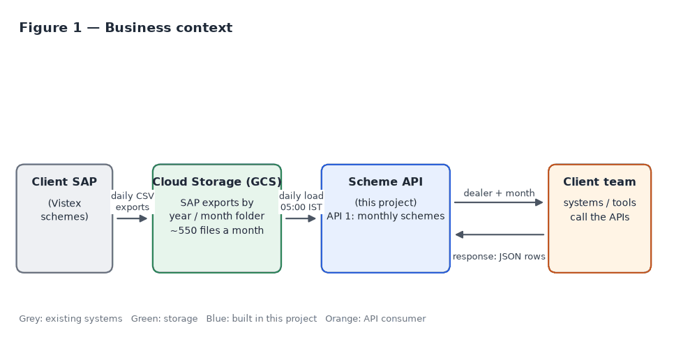
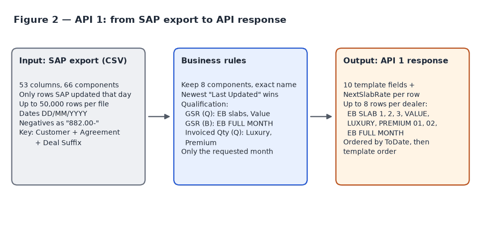
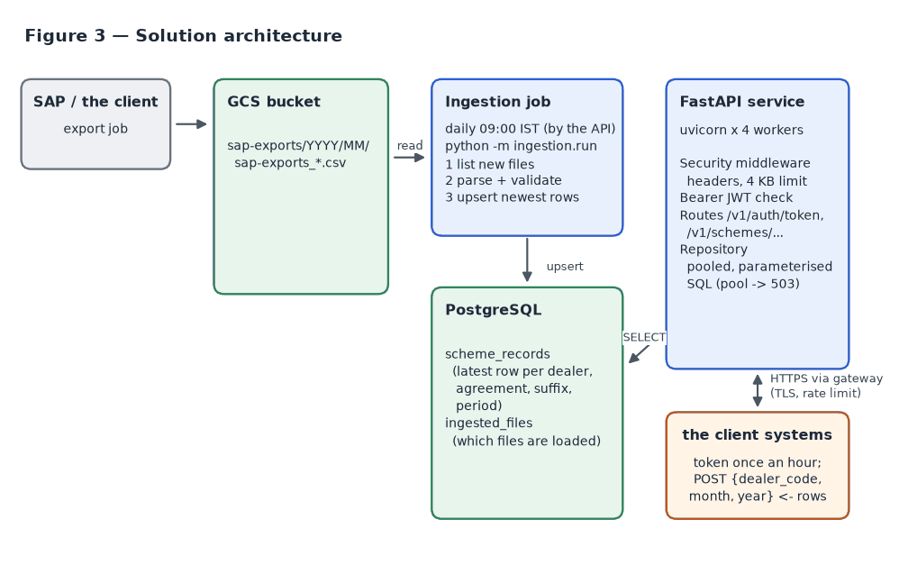
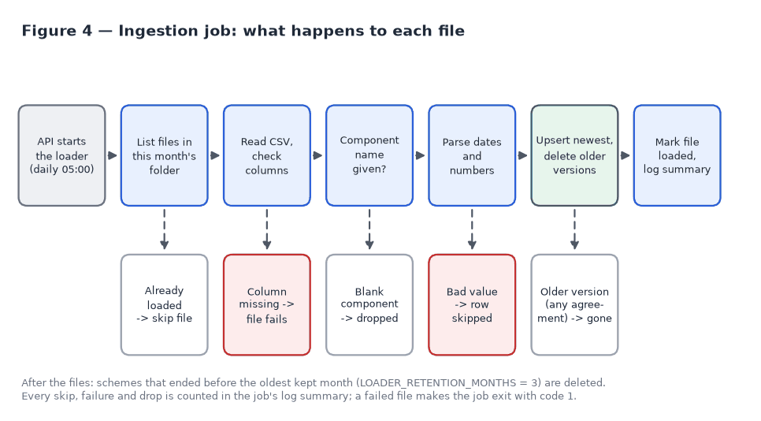
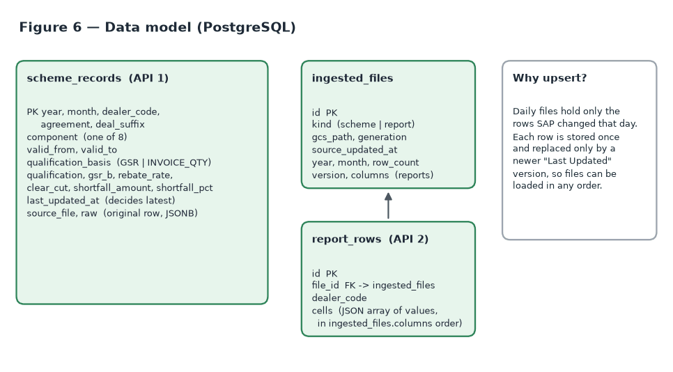
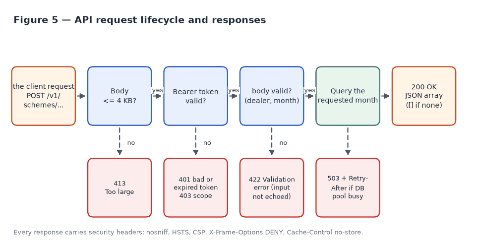

# Scheme API — Requirements & Solution Document

| | |
|---|---|
| Project | Scheme API (API 1: monthly schemes, API 2: dealer report) |
| Consumer | client team |
| Version | 0.3 (draft) — API 2 on hold; Redis response cache for 1 lakh requests a minute |
| Date | 15 October 2026 |
| Author | Mayur Chaudhary |
| Status | API 1 built and tested on sample and real SAP data. **API 2 is on hold** (since 15 October 2026): it was built and tested on the real report sample (January 2024, 30,000 dealers × 900 columns), and is now switched off (endpoint returns 404, no QA assets run) until the requirement resumes. |

> **API 2 is on hold (15 October 2026).** Only API 1 is served. API 2's endpoint, report queries
> and loader command are commented out in the code, and its Postman collection, Swagger spec,
> Playwright file and k6 mode are switched off. Its requirements and design stay in this document,
> marked "on hold", for when it resumes.

## Index

**Part A — Requirements**

1. Purpose and scope
2. Business context
3. Functional requirements
4. Input data: SAP scheme export (API 1) and generated report (API 2)
5. Output: API 1 response template and API 2 report row
6. Non-functional requirements
7. Assumptions
8. Open questions and dependencies

**Part B — Solution**

9. Solution overview and architecture
10. Technology stack
11. Data ingestion design
12. Data model
13. API specification
14. Error handling
15. Security design
16. Configuration
17. Project structure
18. Deployment and operations
19. Postman collections and Swagger specs
20. Testing and quality results

**Appendices**

- A. Example API calls
- B. Glossary

**List of figures**

- Figure 1 — Business context
- Figure 2 — API 1: from SAP export to API response
- Figure 3 — Solution architecture
- Figure 4 — Ingestion job: what happens to each file
- Figure 5 — API request lifecycle and responses
- Figure 6 — Data model (PostgreSQL)

# Part A — Requirements

## 1. Purpose and scope

The client team needs Scheme data for individual dealers. Scheme data is produced in SAP and
exported as files to Google Cloud Storage (GCS). This project builds two APIs that serve that data
by dealer code.

**In scope**

- API 1 — a dealer's scheme position for a month the caller chooses (8 scheme components).
- API 2 — a dealer's row from the latest monthly report generated by the Scheme Automation platform.
- A scheduled job that loads the SAP exports and reports from GCS into a database.
- Documentation, Postman collections (one per API), and functional, performance and security testing.

**Out of scope**

- Earlier reports (API 2 returns the latest report only).
- Changing data in SAP or GCS; the APIs are read-only.
- A user interface.

## 2. Business context

SAP exports scheme data every day into GCS, one folder per month. The Scheme Automation platform
(an internal team application) also writes a generated report for each month to GCS
(`automated-generated-files/output/<year>/<month>/`), with a version number in the file name. The
APIs read this data and return it to the client's systems on request.



## 3. Functional requirements

| ID | Requirement | Priority |
|---|---|---|
| FR-1 | API 1 takes a dealer code, a month and a year in the request body and returns that dealer's scheme rows for that month. | Must |
| FR-2 | API 1 returns only these 8 components: EB SLAB 1, EB SLAB 2, EB SLAB 3, VALUE, LUXURY, PREMIUM 01, PREMIUM 02, EB FULL MONTH. All other SAP components are excluded. | Must |
| FR-3 | API 1 returns the columns of the agreed API template (section 5). | Must |
| FR-4 | EB slabs are returned as separate rows (one row per slab). | Must |
| FR-5 | Qualification is the GSR value for EB and Value, and the invoiced quantity for Premium and Luxury. EB FULL MONTH follows the same GSR working as the EB slabs. | Must |
| FR-6 | Rows are sorted by validity date. | Must |
| FR-7 | Only the requested month's data is returned. A row belongs to the month of the GCS folder its file came from. The database keeps every month. | Must |
| FR-8 | SAP exports are loaded from GCS automatically by a scheduled (cron) job. | Must |
| FR-9 | Each daily file holds only that day's updates, so the API must show the latest version of every row across all of the month's files. | Must |
| FR-10 | API 2 takes only a dealer code and returns that dealer's row from the report the Scheme Automation platform generated and stored in GCS. | Must |
| FR-11 | The report's two header rows (group, then column) are joined into one column name per column, e.g. "Value Slab" + "GSR(Q) Value" becomes `value_slab_gsr_q_value`. All of the report's columns are returned, in the report's order. | Must |
| FR-12 | Dealer code and customer code are the same identifier. | Must |
| FR-13 | API 2 serves the latest report: the newest `<year>/<month>` folder, and within it the highest version (`_v2` replaces `_v1`). | Must |
| FR-14 | Reports are loaded from GCS automatically by the same scheduled job as the SAP exports. | Must |

## 4. Input data

### 4.1 API 1 — SAP scheme export

| Property | Value |
|---|---|
| Location | `gs://acme-scheme-files/sap-exports/<year>/<month>/`, e.g. `.../2026/10/`; a new folder each month |
| File name | `sap-exports_YYYY_MM_main_YYYYMMDD_HHMMSS_NNN.csv` (NNN = part number) |
| Format | CSV, one header row, 53 columns |
| Size | Up to 50,000 rows per file; large exports are split into parts; about 550 files a month |
| Content | Only the rows SAP updated on that day (not a full snapshot); one file contains many dealers |
| Components | 66 different components ("Comp desc"); 8 are used |
| Row identity | Customer + Agreement + Deal Suffix (unique within a file) |
| Dates | DD/MM/YYYY; empty dates appear as 00/00/0000 |
| Numbers | Trailing spaces; negative numbers have the minus sign at the end, e.g. `882.00-` |

SAP columns used by API 1:

| SAP column | Used for |
|---|---|
| Customer | Dealer code |
| Agreement, Deal Suffix | Row identity |
| Comp desc | Component name (filter to the 8 components) |
| Valid from, To | Validity period |
| GSR (Q) | Qualification for EB SLAB 1–3 and Value |
| Invoiced Quantity(Q) | Qualification for Luxury and Premium |
| GSR (B) | GSR B |
| Rebate Rate | Rebate rate |
| Clear Cut CN | Clear cut |
| Short Fall, Short Fall % | Shortfall amount and percentage |
| Last Updated Date, Last Updated Time | Deciding which version of a row is the latest |



### 4.2 API 2 — generated report (on hold)

Based on the sample `automated-generated-files_output_2024_01_output_January_2024_grouped_v1.xlsx`.

| Property | Value |
|---|---|
| Location | `gs://acme-scheme-files/automated-generated-files/output/<year>/<month>/`, e.g. `.../2024/01/` |
| File name | `automated-generated-files_output_YYYY_MM_output_<Month>_YYYY_grouped_v<N>.xlsx` (N = version) |
| Format | Excel, one sheet ("Output"), two header rows |
| Size | About 100 MB: 30,000 dealers × 900 columns (about 30 million cells, a third of them empty) |
| Content | One row per dealer (`Customer` is unique); a full snapshot for the month, not a delta |
| Header row 1 | Group names, each merged over its columns: Value Slab, ALWD Value Slab, Early Bird, ALWD Early Bird, Luxury, Premium, Waterproofing, Primer, Enamel, … (48 groups) |
| Header row 2 | Column names within the group, e.g. GSR(Q) Value, GSR(B) Value, Value CN%, Clear Cut, Short Fall Value, Condonation Amount |
| Fixed columns | Zone, Region, Depot Code, Customer, Customer Name (merged over both header rows, no group) |
| Numbers | Saved as 32-bit floats, so 0.4 is stored as 0.4000000059604645 and 66.86 as 66.86000061035156 |

## 5. Output

### 5.1 API 1 — response template

One row per component, matching the agreed API template:

| Template column | API field | Type |
|---|---|---|
| Customer | `Customer` | string |
| From Date | `FromDate` | date (YYYY-MM-DD) |
| To Date | `ToDate` | date (YYYY-MM-DD) |
| Component description | `ComponentDescription` | string |
| Qualification (GSR / invoiced qty) | `Qualification` | number |
| GSR B | `GsrB` | number |
| Rebate rate | `RebateRate` | number |
| Clear cut | `ClearCut` | number |
| Shortfall Amount | `ShortfallAmount` | number |
| Short fall % | `ShortfallPct` | number |

### 5.2 API 2 — report row (on hold)

One object per dealer, with every column of the report in the report's order. Field names are the
two header rows joined, in lowercase, with every run of other characters replaced by `_` and `%`
written as `pct`:

| Report group | Report column | API field |
|---|---|---|
| — | Zone, Region, Depot Code, Customer, Customer Name | `zone`, `region`, `depot_code`, `customer`, `customer_name` |
| Value Slab | GSR(Q) Value | `value_slab_gsr_q_value` |
| Value Slab | Value CN% | `value_slab_value_cn_pct` |
| Early Bird | Clear Cut | `early_bird_clear_cut` |
| Luxury | Clear Cut | `luxury_clear_cut` |

Values are numbers or text as in the report; empty cells are `null`. A name that would still repeat
gets `_2` (in the sample: two groups named "Group A" and "GROUP A", and repeated "Per Litre"
columns in the Luxury group, 13 columns in all; see open question 8).

## 6. Non-functional requirements

| ID | Area | Requirement | Target |
|---|---|---|---|
| NFR-1 | Performance | Response time at expected load (150 concurrent users) | p95 < 500 ms, p99 < 1 s, errors < 1% |
| NFR-8 | Performance | Peak load from the dealer app: planned 600 requests a minute, observed up to 1 lakh a minute | 1,700 requests/s with < 1% errors; Redis response cache (section 18.1) |
| NFR-2 | Availability | When overloaded, fail fast with a retryable response instead of hanging | 503 with Retry-After within 5 s |
| NFR-3 | Freshness | New SAP exports appear in the API without manual steps | Within one cron cycle (suggested 30 minutes) |
| NFR-4 | Security | Protected against OWASP API Top 10 risks; no data leakage in errors | No ZAP failures, no bandit findings, no known CVEs |
| NFR-5 | Auditability | Every stored row keeps its original SAP values and source file name | Raw row stored with each record |
| NFR-6 | Reliability | Re-running the job or loading files out of order never produces wrong data | Idempotent loads; newest update wins |
| NFR-7 | Maintainability | Automated tests at unit, API, performance and security level | All suites runnable from the repository |

## 7. Assumptions

These assumptions were made while building the solution. Please confirm or correct them.

| ID | Assumption | Basis |
|---|---|---|
| A-1 | The caller (the client) chooses the month: `month` 1–12 and `year` 2000–2100, as JSON numbers or numeric strings. A month whose SAP exports have not been loaded returns an empty list. The cron job loads the current month, decided in India time (Asia/Kolkata); earlier months are loaded once with `ingestion.run schemes --year --month`. | Team decision (the client sends the month) |
| A-2 | A row belongs to the month of the folder its file is in. A scheme running across two months is reported in the folder's month. | Confirmed in discussion |
| A-3 | The API template's date headers are swapped (the column labelled "To Date" holds start dates). The API returns `FromDate` = SAP "Valid from" and `ToDate` = SAP "To". | Template sample values |
| A-4 | The template is the final output. Next slab rate, prepaid rate and customer name (from the first discussion) are not returned; "Rebate rate" is taken to be the rate that was meant. | Confirmed: follow the template |
| A-5 | A row is identified by Customer + Agreement + Deal Suffix. The version with the newest "Last Updated Date/Time" is kept; with equal timestamps the file loaded later wins. | Sample file analysis |
| A-6 | "Last Updated" times from SAP use one time zone and can be compared across files. | Single SAP system |
| A-7 | Component names are matched exactly as SAP spells them (e.g. `PREMIUM 01`). If SAP renames a component, the list in `app/constants.py` must be updated. | Look-alikes such as `ALWD EB2` and `ADDTNL PREMIUM 01` must be excluded |
| A-8 | Qualification uses GSR (Q) for EB SLAB 1–3 and VALUE, and Invoiced Quantity (Q) for LUXURY, PREMIUM 01 and PREMIUM 02. EB FULL MONTH follows the EB slab working: SAP leaves its GSR (Q) empty, and on slab rows GSR (Q) always equals GSR (B), so its Qualification is GSR (B). Real sample: GSR (Q) = GSR (B) on every slab row; GSR (Q) empty on every EB FULL MONTH row. | Discussion and template values |
| A-9 | Dealer codes are compared without leading zeros (`0006100000001` = `6100000001`) and contain only letters and digits, at most 20 characters. | SAP pads codes with zeros |
| A-10 | If a dealer has more than one agreement, one row per agreement per component is returned. The sample data has one agreement per dealer. | Sample file analysis |
| A-11 | An unknown dealer, or a dealer without data in the requested month, returns `200` with an empty list, not `404`. | Simplest for consumers |
| A-12 | The APIs use `POST` with a JSON body, and response fields use PascalCase like the existing dealer APIs. | Discussion; existing Acme APIs |
| A-13 | SAP exports are in bucket `acme-scheme-files`, folder `sap-exports/<year>/<month>/` (confirmed: `sap-exports/2026/10`). Folders for January–September are assumed to be `01`–`09`; the job falls back to `1`–`9` if those don't exist. Generated reports are in `automated-generated-files/output/<year>/<month>/` (confirmed: `.../2024/01`). | Paths confirmed |
| A-14 | API 2 serves the latest report: newest month folder, then highest `_v<N>`, then newest upload. Older reports are not loaded. The dealer column is `Customer`; the file has two header rows and its data on the first sheet. | Report sample and file naming |
| A-15 | No authentication was agreed for now. API key support (`X-API-Key`) is built in and switched on by setting `API_KEY`; turning it on is recommended. Local development has it on by default (`API_KEY=local-test-key`, matching the Postman Local environment). | Discussion; security review |
| A-16 | The project team's existing PostgreSQL database is used. A separate database can be created quickly if needed. | Decision in discussion |
| A-17 | The cron job runs every 30 minutes; SAP exports arrive several times a day. | ~550 files a month |
| A-18 | HTTPS termination and rate limiting are provided by the hosting gateway or load balancer. | Standard deployment |
| A-19 | Expected load is modelled as 150 concurrent users, as in the existing dealer API tests. Actual the client call volumes are not known. | Existing test practice |
| A-20 | Only `.csv` and `.xlsx` files are loaded from GCS. | Formats seen so far |
| A-21 | In the report, a blank group-name cell belongs to the group on its left (the group names are merged cells). | All 48 groups in the sample are merged this way |
| A-22 | Report numbers are rounded to remove 32-bit-float noise: 7 significant digits, keeping at least 2 decimals (`0.4000000059604645` → `0.4`, `1182950.75` stays). The largest change on the sample was 0.000006%. | Report generator writes 32-bit floats |
| A-23 | API 2 returns every report column as-is (no selection or renaming beyond joining the headers). | Teammate shared the report as the format |
| A-24 | EB amounts are running totals from the 1st of the month: EB SLAB 1 (e.g. 1–10 Oct, 10 lakh) is included in EB SLAB 2 (1–15 Oct, 12 lakh), so 2 lakh were added, not 22 lakh in total. The API returns each row as SAP sends it and never adds rows together; a newer SAP update of the same row replaces it. Consumers must not sum the slabs. | Confirmed by the team; real sample: EB amounts never decrease from slab to slab (every dealer checked) |

## 8. Open questions and dependencies

| # | Item | Needed for |
|---|---|---|
| 1 | GCS access (service-account key); both GCS paths are confirmed | Connecting to real data |
| 2 | Database credentials | Production data load |
| 3 | **API 2 is on hold.** ~~API 2 report sample file~~ Received (January 2024, v1). When it resumes: confirm that the client should get the latest month's report, or send a month for API 2 too, like API 1 | API 2 behaviour |
| 4 | Decision on API key authentication | Security (recommended) |
| 5 | Deployment environment and base URLs (Dev, Production) | Go-live, HTTPS and rate-limit checks |
| 6 | Whether the interactive docs page (`/docs`) is public in production | Security configuration |
| 7 | ~~Start of month behaviour~~ Resolved: the client sends the month, so a month without data simply returns `[]`. | — |
| 8 | The report has two groups named "Group A" and "GROUP A", and repeats the "Per Litre" columns in the Luxury group. Intended, or should they be renamed in the report? | API 2 field names |
| 9 | Is rounding the 32-bit-float noise acceptable (assumption A-22), or should values be returned exactly as stored? | API 2 values |
| 10 | ~~Month in the API 1 request~~ Built: `month` and `year` are required. Remaining: which earlier months must be loaded (backfilled) before go-live, and whether the endpoint should be renamed (its path still says `current-month`). | Go-live data, API naming |
| 11 | Redis on UAT/Production: the `REDIS_URL` already set up for other dealer APIs, and whether this API shares it | Response cache |

# Part B — Solution

## 9. Solution overview and architecture

The solution has two parts that share a PostgreSQL database:

1. **Ingestion job (cron).** Lists new files in GCS, validates and parses them, and stores the
   latest version of each scheme row and the latest report. Files already loaded are skipped.
2. **API service (FastAPI).** Answers dealer lookups from the database. Each request is a single
   indexed query, so responses are fast and do not depend on file sizes.

Separating loading from serving means the API never parses files during a request, and a bad file
cannot break the API.



## 10. Technology stack

| Layer | Technology | Why |
|---|---|---|
| Language | Python 3.10+ | Team standard; same as the existing Acme APIs |
| API framework | FastAPI + uvicorn | Same as the existing Acme APIs; automatic OpenAPI docs and input validation |
| Database | PostgreSQL 16 (psycopg 3, connection pool) | Existing team database; upserts and JSON columns |
| File storage | Google Cloud Storage (google-cloud-storage) | Where the SAP exports already land |
| Excel / CSV | openpyxl (streaming read-only mode), csv | Reads multi-row headers; streams a 100 MB report row by row in ~200 MB of memory |
| Packaging | uv | Locked, reproducible dependencies |
| Testing | pytest, Postman/newman, Playwright, k6, bandit, pip-audit, OWASP ZAP | Unit, API, performance and security coverage |

## 11. Data ingestion design

The cron job runs `python -m ingestion.run schemes` and `python -m ingestion.run reports`.
Each `schemes` run reads the current month's folder, `gs://acme-scheme-files/sap-exports/<year>/<month>/`
(for example `.../2026/10/`, then `.../2026/11/`). Months 1–9 are tried as `01` first, then `1`,
and the job logs a warning if the folder has no files yet. The API itself never reads GCS: it only
reads the database the job keeps up to date.



Key design points:

- **Skip loaded files.** Each loaded file is recorded with its GCS version ("generation"). An
  unchanged file is skipped; a re-uploaded file is loaded again.
- **Upsert, newest wins.** Rows are inserted or updated by Customer + Agreement + Deal Suffix. An
  existing row is replaced only if the new one has a newer or equal "Last Updated" time, so files
  can arrive in any order.
- **One transaction per file.** A file is either fully loaded or not at all.
- **Fast loading.** The next `LOADER_WORKERS` files (default 4) are downloaded and parsed in
  parallel while the current one is saved (still one at a time, in order). Each file's rows go to
  the database with one bulk `COPY` into a temporary table and one `INSERT … SELECT … ON CONFLICT`,
  which gives exactly the result of upserting the rows one by one (proved by a randomized database
  test). Real September files: about 6 s per file from a laptop (download-bound), against about 30 s
  with one statement per row; saving takes 0.3–0.5 s.
- **One run at a time.** A Postgres advisory lock stops a second run (e.g. the next cron run during
  a long backfill); it is released when the run's connection closes, even if the process dies.
  After a network drop the server may keep the old session (and the lock) alive; the run names its
  sessions, so on reconnect it ends its own stale session and carries on.
- **Fail loudly on format changes.** If a required column is missing, the file fails with an error
  that lists the missing and available columns; nothing is loaded from it.
- **Row-level tolerance.** A row with an unparseable value is skipped and logged; the rest of the
  file loads.
- **Summary log.** Each run logs files loaded/skipped/failed and rows loaded/dropped/bad, and exits
  with code 1 if any file failed (so the scheduler can alert).

Performance: a 50,000-row SAP file loads in about 1.6 seconds; 160,000 rows in 13 seconds.

### 11.1 Generated reports (API 2, on hold)

`python -m ingestion.run reports` lists `gs://acme-scheme-files/automated-generated-files/output/`
and picks the latest report: newest `<year>/<month>` folder, then highest `_v<N>`, then newest
upload. If that file (path + GCS version) is already loaded, the run ends; otherwise it loads it.
Older reports are never loaded, since API 2 only serves the latest.

- **Streaming read.** The workbook is read row by row (openpyxl read-only mode) and written to the
  database in batches of 1,000 rows, so memory stays around 200 MB for a 100 MB file.
- **Header joining.** In streaming mode merged cells are not visible, so each group name is copied
  to the blank cells on its right (assumption A-21), then joined with the column name (FR-11).
- **Number cleanup.** 32-bit-float noise is rounded away (assumption A-22).
- **Required column.** If there is no `Customer` column the file fails with an error listing the
  first columns found. Rows without a dealer code are skipped and counted (`rows_bad`).
- **Switch-over.** The new report is stored in one transaction; API 2 keeps serving the previous
  report until the new one is fully loaded.

Measured on the real sample: 30,000 rows × 900 columns loaded in 106 seconds using 180 MB of
memory, and 36 MB in Postgres. Every value of 300 dealers (270,000 cells) was compared with the
file: no differences beyond the float cleanup (largest change 5.7 × 10⁻⁸ relative).

## 12. Data model



| Table | Purpose | Key |
|---|---|---|
| `scheme_records` | Latest version of each SAP scheme row for API 1, plus the original row as JSON | year, month, dealer_code, agreement, deal_suffix |
| `report_rows` | One row per dealer of the loaded report for API 2: the values as a JSON array, in the order of the file's column names | id; indexed by file and dealer |
| `ingested_files` | Which files have been loaded, their GCS version and row count; for reports also year, month, version (`_v<N>`) and the column names (JSON) | kind + gcs_path |

The report's column names are stored once per file instead of in every row: with ~870 columns this
keeps a report at about 36 MB in Postgres instead of about 1.4 GB. The API zips names and values
back together for each response. `python -m ingestion.run init-db` creates the tables and upgrades
older databases in place.

## 13. API specification

**Conventions**

| Item | Value |
|---|---|
| Base path | `/v1` |
| Format | JSON request and response, UTF-8 |
| Method | `POST` with a JSON body: API 1 `{"dealer_code", "month", "year"}`, API 2 `{"dealer_code"}` |
| Authentication | `X-API-Key` header (when enabled) |
| Field naming | PascalCase in API 1 responses |
| Empty result | `200` with `[]` |
| Specification | OpenAPI 3: `docs/openapi.json` (both APIs) and one Swagger spec per API in `qa/swagger/`; Swagger UI at `/docs` when enabled |

**Endpoints**

| Method | Path | Description | Auth |
|---|---|---|---|
| POST | `/v1/schemes/current-month` | API 1 — dealer's scheme rows for the requested month | X-API-Key |
| POST | `/v1/schemes/report` | API 2 — dealer's row from the latest generated report | X-API-Key |
| GET | `/health` | Liveness check, returns `{"ok": true}` | None |

### 13.1 Request body

API 1:

```json
{ "dealer_code": "6100000001", "month": 10, "year": 2026 }
```

API 2:

```json
{ "dealer_code": "6100000001" }
```

| Field | API | Type | Rules |
|---|---|---|---|
| `dealer_code` | 1 and 2 | string or number | Required; letters and digits; 1–20 characters; leading zeros and surrounding spaces ignored |
| `month` | 1 | integer or numeric string | Required; 1–12; `true`/`false`, decimals and text are rejected (422) |
| `year` | 1 | integer or numeric string | Required; 2000–2100 |

### 13.2 API 1 — `POST /v1/schemes/current-month`

**Example call**

```bash
curl -X POST "https://<host>/v1/schemes/current-month" \
  -H "Content-Type: application/json" \
  -H "X-API-Key: <your key>" \
  -d '{"dealer_code": "6100000001", "month": 10, "year": 2026}'
```

**Example response — `200 OK`** (sample dealer; all 8 components)

```json
[
  {"Customer": "6100000001", "FromDate": "2026-10-01", "ToDate": "2026-10-11", "ComponentDescription": "EB SLAB 1", "Qualification": 405232.86, "GsrB": 405232.86, "RebateRate": 0.75, "ClearCut": 0.0, "ShortfallAmount": 0.0, "ShortfallPct": 0.0},
  {"Customer": "6100000001", "FromDate": "2026-10-01", "ToDate": "2026-10-18", "ComponentDescription": "EB SLAB 2", "Qualification": 405232.86, "GsrB": 405232.86, "RebateRate": 0.75, "ClearCut": 0.0, "ShortfallAmount": 0.0, "ShortfallPct": 0.0},
  {"Customer": "6100000001", "FromDate": "2026-10-01", "ToDate": "2026-10-25", "ComponentDescription": "EB SLAB 3", "Qualification": 405232.86, "GsrB": 405232.86, "RebateRate": 0.75, "ClearCut": 0.0, "ShortfallAmount": 0.0, "ShortfallPct": 0.0},
  {"Customer": "6100000001", "FromDate": "2026-10-01", "ToDate": "2026-10-31", "ComponentDescription": "VALUE", "Qualification": 405232.86, "GsrB": 405232.86, "RebateRate": 0.0, "ClearCut": 0.0, "ShortfallAmount": 0.0, "ShortfallPct": 0.0},
  {"Customer": "6100000001", "FromDate": "2026-10-01", "ToDate": "2026-10-31", "ComponentDescription": "LUXURY", "Qualification": 315.1, "GsrB": 159292.8, "RebateRate": 1.0, "ClearCut": 1592.93, "ShortfallAmount": 84.9, "ShortfallPct": 21.23},
  {"Customer": "6100000001", "FromDate": "2026-10-01", "ToDate": "2026-10-31", "ComponentDescription": "PREMIUM 01", "Qualification": 0.0, "GsrB": 0.0, "RebateRate": 0.0, "ClearCut": 0.0, "ShortfallAmount": 40.0, "ShortfallPct": 100.0},
  {"Customer": "6100000001", "FromDate": "2026-10-01", "ToDate": "2026-10-31", "ComponentDescription": "PREMIUM 02", "Qualification": 0.0, "GsrB": 0.0, "RebateRate": 0.0, "ClearCut": 0.0, "ShortfallAmount": 8.0, "ShortfallPct": 100.0},
  {"Customer": "6100000001", "FromDate": "2026-10-01", "ToDate": "2026-10-31", "ComponentDescription": "EB FULL MONTH", "Qualification": 405232.86, "GsrB": 405232.86, "RebateRate": 2.25, "ClearCut": 0.0, "ShortfallAmount": 0.0, "ShortfallPct": 0.0}
]
```

**Response fields**

| Field | Type | Meaning | SAP source |
|---|---|---|---|
| `Customer` | string | Dealer code | Customer |
| `FromDate` | date | Start of validity | Valid from |
| `ToDate` | date | End of validity | To |
| `ComponentDescription` | string | One of the 8 components | Comp desc |
| `Qualification` | number | GSR (EB, Value) or invoiced quantity (Luxury, Premium) | GSR (Q); GSR (B) for EB FULL MONTH; Invoiced Quantity(Q) |
| `GsrB` | number | Gross Sales Revenue for the benefit | GSR (B) |
| `RebateRate` | number | Rebate rate | Rebate Rate |
| `ClearCut` | number | Clear-cut credit note amount | Clear Cut CN |
| `ShortfallAmount` | number | Shortfall to the next slab | Short Fall |
| `ShortfallPct` | number | Shortfall as a percentage | Short Fall % |

Ordering: by `ToDate`, then in the order EB SLAB 1, EB SLAB 2, EB SLAB 3, VALUE, LUXURY,
PREMIUM 01, PREMIUM 02, EB FULL MONTH. Amounts can be negative or `null`.

### 13.3 API 2 — `POST /v1/schemes/report` (on hold: returns 404)

**Example call**

```bash
curl -X POST "https://<host>/v1/schemes/report" \
  -H "Content-Type: application/json" \
  -H "X-API-Key: <your key>" \
  -d '{"dealer_code": "6100000001"}'
```

**Example response — `200 OK`** (made-up sample report; the real report has ~870 fields, about 40 KB)

```json
[
  {"zone": "Central", "region": "Bihar North", "depot_code": "1302", "customer": "6100000001",
   "customer_name": "Sample Paints", "value_slab_gsr_q_value": 125000.5, "value_slab_gsr_b_value": 125000.5,
   "value_slab_value_cn_pct": 0.4, "value_slab_short_fall_value": 33431.36,
   "value_slab_short_fall_pct_value": 66.86, "early_bird_gsr_q_eb_1": 336479.88,
   "early_bird_clear_cut": null, "luxury_clear_cut": 1592.93}
]
```

A dealer not in the latest report returns `200 OK` with `[]`.

### 13.4 Request lifecycle



## 14. Error handling

All errors are JSON with a `detail` field. Errors never include stack traces, SQL, internal
addresses or the caller's input.

| Status | Meaning | Example body | Client action |
|---|---|---|---|
| 200 | Success (possibly `[]`) | `[...]` | — |
| 401 | Missing or wrong API key | `{"detail": "Invalid or missing API key"}` | Check the key |
| 404 | Unknown path | `{"detail": "Not Found"}` | Check the URL |
| 405 | Wrong method | `{"detail": "Method Not Allowed"}` | Use POST |
| 413 | Body over 4 KB | `{"detail": "Request body too large"}` | Send only `dealer_code` |
| 422 | Invalid body | `{"detail": [{"loc": ["body", "dealer_code"], "msg": "Field required", "type": "missing"}]}` | Fix the request |
| 503 | Temporarily busy | `{"detail": "Service busy, please retry"}` + `Retry-After: 2` | Retry with backoff |
| 500 | Unexpected error | `{"detail": "Internal server error"}` | Report with time of request |

## 15. Security design

| Control | Implementation |
|---|---|
| Authentication | `X-API-Key` header, constant-time comparison; `/health` stays open for probes |
| Input validation | `dealer_code`: letters and digits, 1–20 characters; API 1 `month` 1–12 and `year` 2000–2100 (no booleans); strict JSON parsing |
| SQL injection | All queries are parameterised; no user input is ever formatted into SQL |
| Payload limits | Request body capped at 4 KB (413), including chunked bodies |
| Response headers | `X-Content-Type-Options: nosniff`, `Strict-Transport-Security` (1 year), `Content-Security-Policy: default-src 'none'`, `X-Frame-Options: DENY`, `Cache-Control: no-store`, `Referrer-Policy: no-referrer`, `Cross-Origin-Resource-Policy: same-origin` |
| Information disclosure | Custom error handlers: no stack traces, no echoed input; server version header disabled |
| Overload protection | Bounded DB connection pool; 503 + Retry-After when exhausted |
| Data exposure | Fixed response model; raw SAP columns are stored but never returned |
| Transport and rate limits | HTTPS and rate limiting at the gateway (assumption A-18) |
| Secrets | API key and DB credentials come from environment variables or the environment's `.env.<env>` file, which is never committed |

## 16. Configuration

All settings are environment variables or a settings file per environment, chosen by `APP_ENV`:
`.env.local` (default), `.env.dev`, `.env.uat`, `.env.prod`. Environment variables win over the file.
One template, `.env.example`, is committed and marks what changes per environment; DevOps fill in
the database, `API_KEY`, Redis and GCS key, and keep the real values in a secret manager. The real
files are ignored by git. Branches `dev`, `uat` and `prod` (from `main`)
are available for per-environment releases.

| Variable | Default | Purpose |
|---|---|---|
| `DATABASE_URL` | local Postgres | Database connection |
| `API_KEY` | `local-test-key` in `.env.example` (local only); unset = no auth | Required `X-API-Key` value; use a long random secret on Dev/Production |
| `DOCS_ENABLED` | `true` | Serve `/docs` and `/openapi.json` |
| `DB_POOL_MAX` | `10` | DB connections per worker process |
| `GCS_BUCKET` | `acme-scheme-files` | Bucket with the files |
| `GOOGLE_APPLICATION_CREDENTIALS` | — | Service-account key file for GCS |
| `GCS_PROJECT` | — | Optional Google Cloud project for the GCS client; reading the bucket works without it |
| `SCHEME_PREFIX_TEMPLATE` | `sap-exports/{year}/{month:02d}/` | Folder of a month's SAP exports (tries `01`, then `1`) |
| `REPORT_PREFIX` | `automated-generated-files/output/` | Folder of generated reports (with `<year>/<month>/` folders inside) |
| `REPORT_HEADER_ROWS` | `2` | Header rows in report files |
| `REPORT_DEALER_COLUMN` | `customer` | Dealer column in reports after joining the headers |
| `APP_ENV` | `local` | Which settings file to read: `.env.local`, `.env.dev`, `.env.uat` or `.env.prod` |
| `LOCAL_DATA_DIR` | — | Read files from a local folder instead of GCS (development) |
| `LOADER_WORKERS` | `4` | Files the cron job downloads and parses in parallel while saving the current one |
| `CACHE_ENABLED` | `false` | Turns the Redis response cache on or off (section 18.1) |
| `REDIS_URL` | — | Redis for the cache, e.g. `redis://host:6379/0`; the cache runs only when this is set and `CACHE_ENABLED=true` |
| `CACHE_TTL_SECONDS` | `900` | Longest a cached response lives; new data replaces it sooner |

## 17. Project structure

```
scheme-api/
├── app/                  FastAPI service
│   ├── main.py           app setup, error handlers, /health
│   ├── routes.py         API 1 and API 2 endpoints
│   ├── schemas.py        request and response models
│   ├── repository.py     SQL queries (connection pool)
│   ├── security.py       X-API-Key check
│   ├── middleware.py     security headers, body size limit
│   ├── constants.py      the 8 components and qualification rules
│   └── config.py         settings from environment variables
├── ingestion/            cron job
│   ├── run.py            entry point: init-db, schemes, reports
│   ├── sources.py        list/read files in GCS (or a local folder)
│   ├── excel.py          CSV/Excel streaming reader, header joining
│   ├── schemes.py        SAP business rules and parsing (API 1)
│   ├── reports.py        report period/version and number cleanup (API 2)
│   └── load.py           upsert / batched insert into PostgreSQL
├── sql/001_init.sql      tables and indexes
├── docs/                 this document, API guide, OpenAPI spec, figures
├── qa/                   QA guide and test results
│   ├── postman/          one collection per API + Local/Dev environments
│   │                     (built by build_collection.py)
│   ├── swagger/          one OpenAPI spec per API (built by build_specs.py)
│   ├── api-tests/tests/  Playwright: api1_current_month.spec.js, api2_report.spec.js,
│   │                     common.spec.js, helpers.js
│   ├── k6/               performance tests (-e API=api1 | api2 | both)
│   └── security/         bandit, pip-audit, OWASP ZAP
├── tests/                unit tests (incl. checks that Postman and Swagger cover every endpoint)
└── scripts/              sample data, OpenAPI export, figures
```

## 18. Deployment and operations

**Local development and testing:** follow *Getting started (step by step)* in the repository
`README.md` (install, sample data, run, try a request, troubleshooting). QA follow the
step-by-step *QA guide* in `qa/README.md`.

**Run the API** in Dev/Production (one worker per CPU core; server version header disabled):

```bash
uv run uvicorn app.main:app --host 0.0.0.0 --port 8000 --workers 4 --no-server-header
```

**Create tables once, then schedule the loader:**

```bash
uv run python -m ingestion.run init-db
# crontab: every 30 minutes
*/30 * * * * cd /path/to/api && uv run python -m ingestion.run schemes
```

(`ingestion.run reports` loads API 2's reports; it is commented out while API 2 is on hold.)

**Operational checks**

- `GET /health` for liveness probes.
- Cron job exit code 1 means at least one file failed; the log names the file and the reason.
- A dropped database connection is retried (5 attempts, 10 s apart); the job resumes from the
  first file not yet loaded, since each file is saved in one transaction.
- Total database connections = workers × `DB_POOL_MAX` (default 40 for 4 workers).

### 18.1 Response cache (Redis)

The dealer app loads data with many parallel requests: about 600 a minute were
planned, up to 1 lakh a minute (≈ 1,700 a second) were seen. The data only changes when the cron
job loads new files, so API responses are cached in Redis, as already done for other dealer APIs on UAT.

- **Switch:** `CACHE_ENABLED=true` and `REDIS_URL` turn it on; either one missing turns it off
  (default off).
- **Key:** API, dealer code (normalised), month and year; empty answers are cached too.
- **Freshness:** every key includes a data version; after loading anything the cron job bumps it,
  so the next request reads the new data. `CACHE_TTL_SECONDS` (900) is the upper bound.
- **Failure:** Redis calls time out after 0.25 s; on an error the API answers from the database
  and does not try Redis again for 30 s. Redis is never required for the API to work.
- **Observability:** `X-Cache: HIT`, `MISS` or `BYPASS` on responses while the cache is on.
- **HTTP caching** stays off (`Cache-Control: no-store`): only the server caches.

Measured on a laptop at 1,700 requests/s for 2 minutes (`qa/k6/rate.js`): without the cache
1,596/s got through, p95 1.4 s; with a warm cache 1,695/s, median 1.3 ms, p95 92 ms; 0 errors in
both (details in section 20).

## 19. Postman collections and Swagger specs

While API 2 is on hold only the API 1 collection and spec are generated.

Files in `qa/postman/`: one collection per API, sharing the environments. They are generated by
`qa/postman/build_collection.py` (edit requests and tests there, then regenerate); a unit test fails
if an API endpoint has no request, or if a collection calls the other API. A copy is kept in the QA
automation repository (`tests/api/scheme_api/`) and updated automatically whenever a collection
changes.

| File | Purpose |
|---|---|
| `Scheme_API1_Current_Month.postman_collection.json` | API 1: requests, automatic tests, example responses (27 requests, 115 assertions) |
| `Scheme_API2_Report.postman_collection.json` | API 2: requests, automatic tests, example responses (20 requests, 91 assertions) |
| `Local.postman_environment.json` | Local development settings (both collections) |
| `Dev.postman_environment.json` | Dev settings (base URL to be filled in) |

Both collections have the same folders:

| Folder | API 1 collection | API 2 collection |
|---|---|---|
| 1. Health | Health check | Health check |
| 2. (the API) | Dealer code as string, as number, with leading zeros; month/year as strings; a month with no data; unknown dealer | Dealer code as string, as number, with leading zeros, unknown dealer; checks one row, `customer`, column order, snake_case keys, value types, no float noise, and (sample data) v2 served, 0.4 / 66.86, `null` for empty cells |
| 3. Negative cases | Missing month, missing year, month 13, year 1999, boolean month; then missing, empty, whitespace, null, special characters, too long, invalid JSON, wrong method, unknown route | The dealer-code cases, against API 2 |
| 4. Security | No key, wrong key, SQL injection, script injection, oversized body, security headers | Same, against API 2 |

**Swagger specs.** `qa/swagger/` holds one OpenAPI 3.1 file per API, for Swagger Editor/UI or any
OpenAPI tool: `Scheme_API1_Current_Month.openapi.json` and `Scheme_API2_Report.openapi.json`.
Each has the API's request and `/health`, the Local and Dev servers, the `X-API-Key` scheme, named
request examples (valid ones, and `invalid_…` ones that return 422), example responses, and every
error status (401, 413, 422, 500, 503). They are cut from the app's own spec by
`qa/swagger/build_specs.py`; the examples live in `app/openapi_examples.py`, so `/docs` shows the
same ones. A unit test fails if a spec is stale or an example does not behave as its name says.

Variables: `baseUrl`, `apiKey` (secret), `dealerCode`, `unknownDealerCode`, `authEnabled`,
`sampleData` (`true` locally; `false` skips the checks of sample values). API 1 sends `month` and
`year`: the current month in India time unless the environment sets `month` and `year`.

How to use:

1. In Postman choose **Import** and select both collections and an environment file.
2. Select the environment. For local testing choose **Scheme API - Local** (`baseUrl`
   `http://localhost:8000`, `apiKey` `local-test-key`, matching the local `.env.local`). For Dev, fill in
   `baseUrl`, `apiKey` and a `dealerCode` with data. Every request inherits the `X-API-Key` header
   from the collection's **Authorization** tab (`{{apiKey}}`), so nothing is set per request.
3. Send any request. Saved examples are under each request's **Examples**.
4. Choose **Run collection** on either collection to run every request with its tests.

Command line:

```bash
npx newman run Scheme_API1_Current_Month.postman_collection.json -e Local.postman_environment.json
npx newman run Scheme_API2_Report.postman_collection.json -e Local.postman_environment.json
```

## 20. Testing and quality results

Test run of 15 October 2026 (API 2 on hold) on a local environment, with earlier results of
14 October 2026 where noted. Environment (Apple M2, PostgreSQL in Docker, API with
4 workers and API key enabled, 20,000 test dealers / 160,017 rows; for API 2 the made-up sample
reports, and the real report sample for the data check and the API 2 load test).

| Suite | Result |
|---|---|
| Unit tests (pytest) | 142 / 142 passed; 13 database tests (`TEST_DATABASE_URL`) passed against local Postgres |
| Postman / newman — API 1 collection | 115 / 115 assertions passed (27 requests) |
| Playwright — API 1 | 65 / 65 passed |
| Playwright — common | 4 passed (incl. API 2 returns 404), 1 skipped (HTTPS redirect check needs the deployed URL) |
| API 2 (on hold; 14 October results) | Postman 91 / 91, Playwright 56 / 56 |
| API 2 data check (real report, 14 October) | 270,000 cells compared with the file: 0 differences beyond the float32 cleanup |
| bandit (static analysis) | 0 issues |
| pip-audit (dependencies) | No known vulnerabilities |
| OWASP ZAP API scan | 119 passed, 0 failures, 0 warnings |

Performance (k6):

| Test | Requests | Errors | p95 | p99 | Result |
|---|---|---|---|---|---|
| API 1 load: 150 users, 3 min | 60,229 | 0.00% | 5.5 ms | 8.6 ms | Pass |
| API 1 stress: up to 600 users | 174,316 | 0.00% | 253.9 ms | 374.8 ms | Pass |
| API 1 spike: 20 → 500 users | 68,715 | 0.00% | 150.5 ms | 401.9 ms | Pass |
| API 2 load, real 900-column rows: 150 users, 3 min (14 October) | 59,954 | 0.00% | 11.6 ms | 55.1 ms | Pass |
| API 1 at 1,700 requests/s (1 lakh/min), 2 min, no cache | 192,986 | 0.00% | 1,385 ms | 1,546 ms | Missed latency (1,596/s achieved) |
| API 1 at 1,700 requests/s, Redis cache warm | 203,345 | 0.00% | 92 ms | 303 ms | Pass (1,695/s achieved) |

Issues found by testing and fixed before this release:

| Issue | Found by | Fix |
|---|---|---|
| Database connection pool deadlock under concurrent load (0.35% timeouts) | k6 load test | Connections borrowed per query; bounded pool; 503 when busy |
| API 2 loader needed several GB of memory for the real report and would have stored ~1.4 GB per report | Real report sample | Streaming read, column names stored once per file (180 MB memory, 36 MB stored) |
| Report numbers carried 32-bit-float noise (`0.4000000059604645`) | Real report sample | Rounded to 7 significant digits, at least 2 decimals (A-22) |
| Validation errors echoed the caller's input | Security review | Custom error handler without input |
| Missing security headers | Security tests, ZAP | Security headers middleware |
| No request size limit | Security tests | 4 KB body limit |
| SAP negative numbers (`882.00-`) would have been rejected | Real SAP file test | Trailing-minus parsing |
| API could not keep up with 1 lakh requests a minute | k6 `rate.js` | Redis response cache; plain-ASGI headers middleware and async light dependencies (cache-hit ceiling 1,705/s → 2,922/s) |
| Loading a month took hours over the VPN (~30 s per file) | Live load of September | Parallel downloads + one bulk `COPY` per file (~6 s per file); one run at a time; `--limit` |

Performance figures come from a laptop and show relative behaviour; they should be re-measured on
the deployed environment.

# Appendices

## A. Example API calls

**Python**

```python
import requests

response = requests.post(
    "https://<host>/v1/schemes/current-month",
    json={"dealer_code": "6100000001", "month": 10, "year": 2026},
    headers={"X-API-Key": "<your key>"},
    timeout=15,
)
response.raise_for_status()
for row in response.json():
    print(row["ComponentDescription"], row["Qualification"], row["GsrB"])
```

**JavaScript (Node 18+)**

```javascript
const response = await fetch('https://<host>/v1/schemes/current-month', {
  method: 'POST',
  headers: { 'Content-Type': 'application/json', 'X-API-Key': '<your key>' },
  body: JSON.stringify({ dealer_code: '6100000001', month: 10, year: 2026 }),
});
if (!response.ok) throw new Error(`HTTP ${response.status}`);
const rows = await response.json();
```

**Error example — invalid dealer code**

```bash
curl -X POST "https://<host>/v1/schemes/current-month" \
  -H "Content-Type: application/json" -H "X-API-Key: <your key>" \
  -d '{"dealer_code": "6100-0001", "month": 10, "year": 2026}'
```

```json
{"detail": [{"loc": ["body", "dealer_code"], "msg": "String should match pattern '^[A-Za-z0-9]+$'", "type": "string_pattern_mismatch"}]}
```

## B. Glossary

| Term | Meaning |
|---|---|
| SAP | Acme's ERP system where schemes are calculated |
| GCS | Google Cloud Storage, where SAP exports and reports are stored |
| EB | Early Bird scheme, paid in slabs within the month (SLAB 1–3) and for the full month |
| GSR | Gross Sales Revenue |
| Component | One scheme line for a dealer (SAP "Comp desc") |
| Agreement / Deal Suffix | SAP identifiers of a dealer's scheme agreement and its component line |
| Upsert | Insert a row, or update it if it already exists |
| VU | Virtual user in a k6 load test |
| p95 / p99 | Response time that 95% / 99% of requests are faster than |
| Cron | Scheduler that runs the loading job at fixed intervals |
