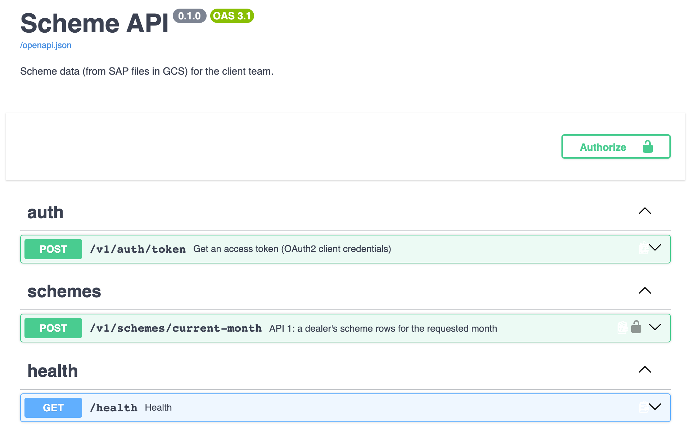
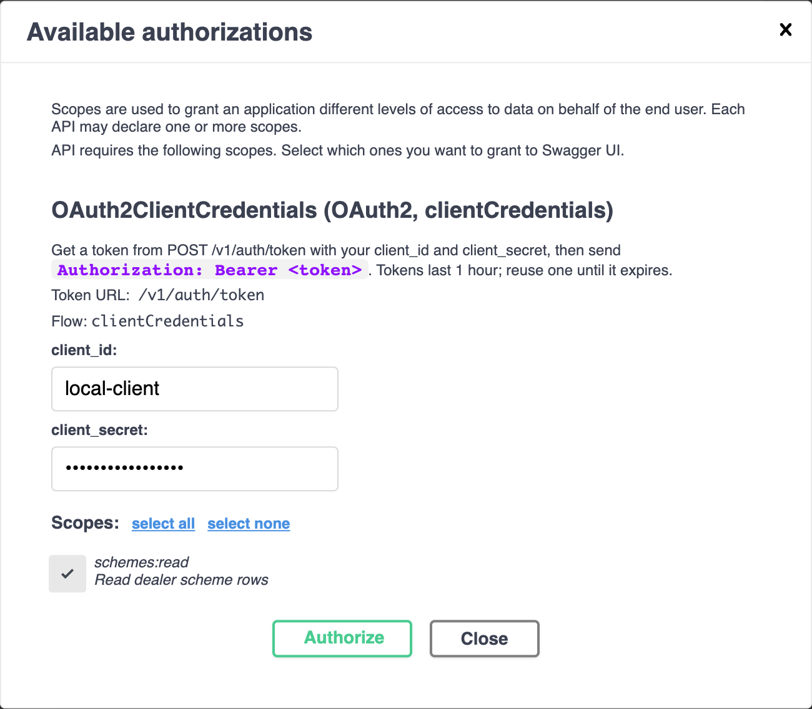
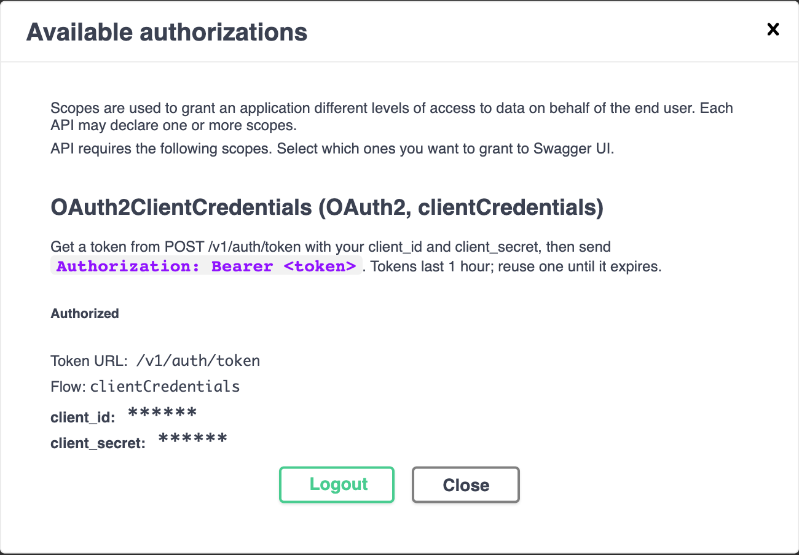
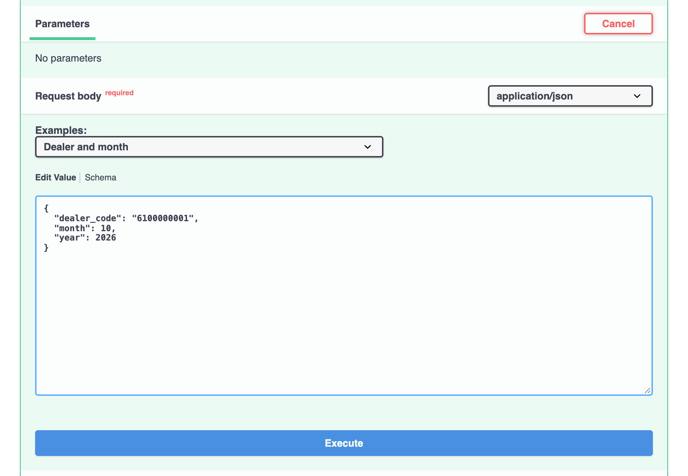
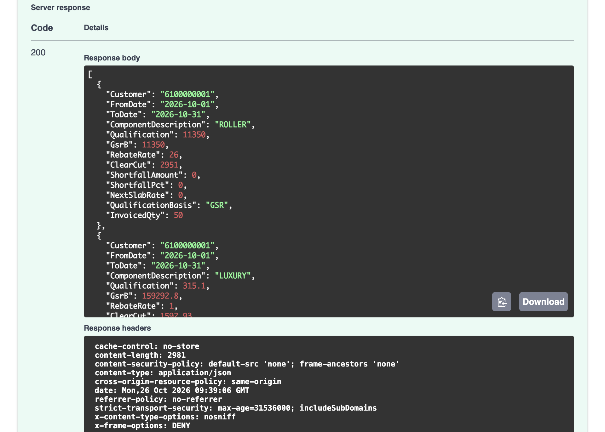

# Scheme API — Requirements & Solution Document

| | |
|---|---|
| Project | Scheme API (API 1: monthly schemes) |
| Consumer | Client team |
| Version | 1.2 — API 1 (monthly schemes) |
| Date | 26 October 2026 |
| Author | Project team |
| Status | API 1 built and tested on sample and real SAP data. |

## Index

**Part A — Requirements**

1. Purpose and scope
2. Business context
3. Functional requirements
4. Input data: SAP scheme export
5. Output: API response template
6. Non-functional requirements
7. Assumptions

**Part B — Solution**

8. Solution overview and architecture
9. Technology stack
10. Data ingestion design
11. Data model
12. API specification
13. Error handling
14. Security design
15. Configuration
16. Project structure
17. Deployment and operations
18. Postman collection and Swagger spec
19. Testing and quality results

**Appendices**

- A. Example API calls
- B. Glossary
- C. User guide: calling API 1

**List of figures**

- Figure 1 — Business context
- Figure 2 — API 1: from SAP export to API response
- Figure 3 — Solution architecture
- Figure 4 — Ingestion job: what happens to each file
- Figure 5 — API request lifecycle and responses
- Figure 6 — Data model (PostgreSQL)
- Figure 7 — Swagger UI: the API's page
- Figure 8 — Swagger UI: Authorize with client_id and client_secret
- Figure 9 — Swagger UI: authorized
- Figure 10 — Swagger UI: request body for a dealer and month
- Figure 11 — Swagger UI: the response

# Part A — Requirements

## 1. Purpose and scope

The client team needs Scheme data for individual dealers. Scheme data is produced in SAP and
exported as files to Google Cloud Storage (GCS). This project builds an API that serves that data
by dealer code.

**In scope**

- API 1 — a dealer's scheme position for a month the caller chooses (every SAP scheme component; the 10 template components as agreed).
- A daily scheduled job that loads the SAP exports from GCS into a database.
- Documentation, a Postman collection, and functional, performance and security testing.

**Out of scope**

- Changing data in SAP or GCS; the API is read-only.
- A user interface.

## 2. Business context

SAP exports scheme data every day into GCS, one folder per month. The API reads this data and
returns it to the client's systems on request.


## 3. Functional requirements

| ID | Requirement | Priority |
|---|---|---|
| FR-1 | API 1 takes a dealer code, a month and a year in the request body and returns that dealer's scheme rows for that month. | Must |
| FR-2 | API 1 returns every SAP component: the 10 agreed template ones (EB SLAB 1, EB SLAB 2, EB SLAB 3, VALUE, VALUE %, VALUE FA, LUXURY, PREMIUM 01, PREMIUM 02, EB FULL MONTH) and all others. Rows of components outside the 10 also carry `QualificationBasis` (`GSR` or `INVOICE_QTY`, what `Qualification` holds) and `InvoicedQty` = Invoiced Quantity (Q). | Must |
| FR-3 | API 1 returns the columns of the agreed API template (section 5). | Must |
| FR-4 | EB slabs are returned as separate rows (one row per slab). | Must |
| FR-5 | Qualification is the GSR value for EB (EB SLAB 1–3, EB FULL MONTH), Value (VALUE, VALUE %, VALUE FA), ROLLER, SANDPAPER and MASKING TAPE, and the invoiced quantity for every other component, Luxury and Premium included (rule of 2026-10-22). EB FULL MONTH follows the same GSR working as the EB slabs. | Must |
| FR-5a | Rows are ordered by Clear Cut, highest first (an empty Clear Cut last); rows with the same Clear Cut keep the template order (end date, the 10 in template order, then other components by name). Requested 2026-10-22. | Must |
| FR-6 | Rows with the same Clear Cut are sorted by validity (end) date (FR-5a); until 2026-10-22 this was the main order. | Must |
| FR-7 | Only the requested month's data is returned. A row belongs to every month its validity period (From–To) overlaps, whichever GCS folder its file came from; each component is returned once per start date (SAP's newest update, see A-5); rows without dates use their folder's month. The database keeps the current month and the two before it (A-24). | Must |
| FR-8 | SAP exports are loaded from GCS automatically on a schedule (daily at 05:00 India time, run by the API itself; section 10). | Must |
| FR-9 | Each daily file holds only that day's updates, so the API must show the latest version of every row across all of the month's files. | Must |
| FR-10 | Dealer code and customer code are the same identifier. | Must |

## 4. Input data

### 4.1 API 1 — SAP scheme export

| Property | Value |
|---|---|
| Location | `gs://acme-scheme-files/sap-exports/<year>/<month>/`, e.g. `.../2026/10/`; a new folder each month |
| File name | `sap-exports_YYYY_MM_main_YYYYMMDD_HHMMSS_NNN.csv` (NNN = part number) |
| Format | CSV, one header row, 53 columns |
| Size | Up to 50,000 rows per file; large exports are split into parts; about 550 files a month |
| Content | Only the rows SAP updated on that day (not a full snapshot); one file contains many dealers |
| Components | 66 different components ("Comp desc") in the Aug sample; 152 in the Sep 2026 folder and 102 in Oct 2026 (186 names in all, only 70 in both months: SAP renames and adds schemes monthly). All are stored and returned; 10 have agreed qualification rules |
| Row identity | Customer + Agreement + Deal Suffix + validity period (Valid from, To) |
| Dates | DD/MM/YYYY (DD.MM.YYYY and DD-MM-YYYY are also read); empty dates appear as 00/00/0000 |
| Numbers | Trailing spaces; negative numbers have the minus sign at the end, e.g. `882.00-` |

SAP columns used by API 1:

| SAP column | Used for |
|---|---|
| Customer | Dealer code |
| Agreement, Deal Suffix | Row identity |
| Comp desc | Component name (the 10 template components have agreed qualification rules) |
| Valid from, To | Validity period |
| GSR (Q) | Qualification for EB SLAB 1–3, Value (VALUE, VALUE %, VALUE FA), ROLLER, SANDPAPER and MASKING TAPE |
| Invoiced Quantity(Q) | Qualification for every other component (Luxury, Premium and the rest); `InvoicedQty` on components outside the 10 |
| GSR (B) | GSR B |
| Rebate Rate | Rebate rate |
| Clear Cut CN | Clear cut |
| Short Fall, Short Fall % | Shortfall amount and percentage |
| Next Slab Rate | Next slab rate (required: a file without this column is rejected) |
| Last Updated Date, Last Updated Time | Deciding which version of a row is the latest |


## 5. Output

### 5.1 API 1 — response template

One row per component: the columns of the agreed API template, then `NextSlabRate` (requested 2026-10-15). Rows of components outside the 10 also carry `QualificationBasis` and `InvoicedQty` (section 12.2):

| Template column | API field | Type |
|---|---|---|
| Customer | `Customer` | string |
| From Date | `FromDate` | date (YYYY-MM-DD) |
| To Date | `ToDate` | date (YYYY-MM-DD) |
| Component description | `ComponentDescription` | string |
| Qualification (GSR / invoiced qty) | `Qualification` | number |
| GSR B | `GsrB` | number |
| Rebate rate | `RebateRate` | number |
| Clear cut | `ClearCut` | number |
| Shortfall Amount | `ShortfallAmount` | number |
| Short fall % | `ShortfallPct` | number |
| Next slab rate (added 2026-10-15, not in the template) | `NextSlabRate` | number |

## 6. Non-functional requirements

| ID | Area | Requirement | Target |
|---|---|---|---|
| NFR-1 | Performance | Response time at expected load (150 concurrent users) | p95 < 500 ms, p99 < 1 s, errors < 1% |
| NFR-8 | Performance | Peak load from the dealer app: planned 600 requests a minute, observed up to 1 lakh a minute | 1,700 requests/s with < 1% errors; Redis response cache (section 17.1) |
| NFR-2 | Availability | When overloaded, fail fast with a retryable response instead of hanging | 503 with Retry-After within 5 s |
| NFR-3 | Freshness | New SAP exports appear in the API without manual steps | Same day: loaded at 05:00 IST (SAP's files land around 04:30–04:51) |
| NFR-4 | Security | Protected against OWASP API Top 10 risks; no data leakage in errors | No ZAP failures, no bandit findings, no known CVEs |
| NFR-5 | Auditability | Every stored row keeps its original SAP values and source file name | Raw row stored with each record |
| NFR-6 | Reliability | Re-running the job or loading files out of order never produces wrong data | Idempotent loads; newest update wins |
| NFR-7 | Maintainability | Automated tests at unit, API, performance and security level | All suites runnable from the repository |

## 7. Assumptions

These assumptions were made while building the solution. Please confirm or correct them.

| ID | Assumption | Basis |
|---|---|---|
| A-1 | The caller (the client) chooses the month: `month` 1–12 and `year` 2000–2100, as JSON numbers or numeric strings (month as `1`–`9`, `01`–`09`, `10`, `11` or `12`; longer forms such as `010` or `0010` are rejected). A month whose SAP exports have not been loaded returns an empty list. The scheduled loader loads the current month, decided in India time (Asia/Kolkata); earlier months are loaded once with `ingestion.run schemes --year --month`. | Team decision (the client sends the month); confirmed 2026-10-21: any month may be requested, and its data is returned if present |
| A-2 | A row belongs to every month its validity period overlaps, not to the folder its file is in. Changed 2026-10-15: dev data showed the September folder also holds SAP updates of August schemes, so the folder rule returned August rows for September. A scheme running across two months is reported in both. A month's full report arrives around the 1st of the next month, in the next month's folder (August's on 1 September). | Decided 2026-10-15 (was: folder month); full-month report timing confirmed 2026-10-21 |
| A-3 | The API template's date headers are swapped (the column labelled "To Date" holds start dates). The API returns `FromDate` = SAP "Valid from" and `ToDate` = SAP "To". | Template sample values |
| A-4 | The template is the final output, plus `NextSlabRate` (SAP "Next Slab Rate"), added after it as the last field of each row on 2026-10-15. Prepaid rate and customer name (from the first discussion) are not returned; "Rebate rate" is taken to be the rate that was meant. | Template confirmed; next slab rate requested 2026-10-15 |
| A-5 | A row is identified by Customer + Agreement + Deal Suffix + Component + validity period (within a GCS month folder; the component joined the key 2026-10-19, as SAP can give two components the same suffix and period). The version with the newest "Last Updated Date/Time" is kept; with equal timestamps the file loaded later wins. The period is part of the key so a month folder can hold the same agreement and suffix for two periods (e.g. a late update of last month's scheme) without one replacing the other. The API returns one row per component and start date (Valid From): the one with the newest "Last Updated" (then the newer folder, then the higher agreement number). So when SAP corrects a row's end date (dev, Sept 2026: EB SLAB 2 1–18 Sep, then 1–19 Sep) or re-issues a dealer's schemes under a new agreement number with the same dates, only the newest version is returned (decided 2026-10-16; replaces the 2026-10-15 rule that returned every stored period). The loader deletes the older versions, so the database holds one row per dealer, component and start date (decided 2026-10-19, A-25). Agreement and deal suffix are compared as SAP writes them (zero-padded); `0010` and `10` are not treated as the same (decided 2026-10-16). | Sample file analysis: validity periods are fixed per scheme (e.g. EB SLAB 2 1–18 Aug, EB SLAB 3 1–25 Aug), not moved daily; reviewed 2026-10-15 |
| A-6 | "Last Updated" times from SAP use one time zone and can be compared across files. | Single SAP system |
| A-7 | Component names are matched exactly as SAP spells them (e.g. `PREMIUM 01`). Every component is stored under its own name, so a renamed or new component is loaded and returned without a code change. Only the 10 template components (`app/constants.py`) need a code change if SAP renames one of them. SAP can give two components the same agreement, deal suffix and period (Oct 2026: ALWD FULL MONTH and ADDN TEXTURE PER 250, suffix 65), so the component is part of the row key. | Look-alikes such as `ALWD EB2`, `ADDTNL PREMIUM 01`, `VALUE SCH %` and `VALUE SCH FA` must be excluded. `VALUE %` and `VALUE FA` added on request (2026-10-16); both spellings found in the Sep/Oct 2026 SAP data |
| A-8 | Qualification uses GSR (Q) for EB SLAB 1–3, VALUE, VALUE %, VALUE FA, ROLLER, SANDPAPER and MASKING TAPE, and Invoiced Quantity (Q) for every other component (LUXURY, PREMIUM 01/02 and the rest; rule of 2026-10-22). Names match SAP's Comp desc exactly, so look-alikes such as ALWD EB2, EB ADD FA 02 or ALWD VALUE SCH are on invoiced quantity. EB FULL MONTH follows the EB slab working: SAP leaves its GSR (Q) empty, and on slab rows GSR (Q) always equals GSR (B), so its Qualification is GSR (B). Real sample: GSR (Q) = GSR (B) on 775 of 775 slab rows; GSR (Q) empty on all 774 EB FULL MONTH rows. VALUE % and VALUE FA follow VALUE (confirmed 2026-10-16); in the Sep/Oct 2026 SAP data their GSR (Q) is filled on 99% of rows, as on VALUE. | Discussion and template values; rule for the other components confirmed 2026-10-22 |
| A-9 | Dealer codes are compared without leading zeros (`0006100000001` = `6100000001`) and contain only letters and digits, at most 20 characters. | SAP pads codes with zeros |
| A-10 | If a dealer has more than one agreement, one row per agreement per component is returned. The sample data has one agreement per dealer. | Sample file analysis |
| A-11 | An unknown dealer, or a dealer without data in the requested month, returns `200` with an empty list, not `404`. | Simplest for consumers; confirmed 2026-10-21 |
| A-12 | The API uses `POST` with a JSON body, and response fields use PascalCase like the existing Acme dealer APIs. | Discussion; existing Acme APIs |
| A-13 | SAP exports are in bucket `acme-scheme-files`, folder `sap-exports/<year>/<month>/` (confirmed: `sap-exports/2026/10`). Folders for January–September are assumed to be `01`–`09`; the job also reads `1`–`9`, so if both exist neither is missed (changed 2026-10-16: it used to stop at the first one). | Path confirmed; QA audit 2026-10-16 |
| A-14 | Callers authenticate with OAuth2 client credentials: each caller (the client, QA) gets a `client_id` and `client_secret` per environment, exchanges them at `POST /v1/auth/token` for a JWT Bearer token valid for 1 hour, and reuses it until shortly before it expires. Outside local development the API does not start without auth settings; auth can be off only when `APP_ENV=local` is set explicitly, so a server that forgets `APP_ENV` does not run open. Locally the client is `local-client` / `local-test-secret` (matching the Postman Local environment); these published values are accepted only with `APP_ENV=local` set explicitly (added 2026-10-16), so a server that forgets `APP_ENV` cannot run on them either. The `X-API-Key` header is no longer accepted. | Decided 2026-10-15 (was: optional `X-API-Key`); security review (explicit `APP_ENV=local` for auth off: security review of 15 October 2026) |
| A-15 | The project team's existing PostgreSQL database is used. A separate database can be created quickly if needed. | Decision in discussion |
| A-16 | The loader runs once a day at 05:00 IST (team decision 2026-10-19 for 09:00, moved to 05:00 on 2026-10-21); SAP exports arrive once a day (in October 2026 about 23 files between 04:30 and 04:51 IST), so data is up to date from 05:00. Files that land after 05:00 wait for the next day's run. | ~550 files a month |
| A-17 | HTTPS termination is provided by the hosting gateway or load balancer. The API itself limits each client IP to 2,500 requests a second (added 2026-10-15). The proxy appends the caller's IP to `X-Forwarded-For`, and its address is listed in `TRUSTED_PROXIES`; `X-Forwarded-For` from any other address is ignored, so a caller cannot choose its own IP (changed 2026-10-16). | Standard deployment; rate limit requested 2026-10-15; QA audit 2026-10-16 |
| A-18 | Expected load is modelled as 150 concurrent users, as in the existing Acme dealer API tests. Actual client call volumes are not known. | Existing test practice |
| A-19 | Only `.csv` and `.xlsx` files are loaded from GCS. | Formats seen so far |
| A-20 | EB amounts are running totals from the 1st of the month: EB SLAB 1 (e.g. 1–10 Oct, 10 lakh) is included in EB SLAB 2 (1–15 Oct, 12 lakh), so 2 lakh were added, not 22 lakh in total. The API returns each row as SAP sends it and never adds rows together; a newer SAP update of the same row replaces it. Consumers must not sum the slabs. | Confirmed by the team; real sample: EB amounts never decrease from slab to slab (775 of 775 dealers) |
| A-21 | A row with no end date ("To" empty) counts as valid for its start day only, so it is returned only for the month of its "Valid from". | Confirmed correct 2026-10-16 |
| A-22 | SAP dates use `/`, `.` or `-` between day, month and year. Dates written with spaces (`01 08 2026`) are not read: such a row is bad and its file is marked failed. | Decided 2026-10-16 (not supported for now) |
| A-23 | Amounts are finite numbers. `NaN` or `Infinity` in an amount column makes the row bad instead of being stored. | QA audit 2026-10-16 |
| A-24 | Only the current month and the two before it are kept (`LOADER_RETENTION_MONTHS` = 3; in October: October, September, August). A scheme is deleted once its period ended before the oldest kept month: judged by its end date, so a scheme that started earlier but runs into a kept month stays. A row without an end date counts as its start day (A-21); a row without dates by its folder month. Older months return no rows. | Decided 2026-10-19; M-2 as the oldest month shown confirmed 2026-10-21 |
| A-25 | One row per dealer, component and start date is stored: the version API 1 returns (A-5). Older versions are deleted, also when SAP re-issued the scheme under another agreement number or corrected its end date. With equal "Last Updated", folder and agreement, the later end date is kept (no end date counts as the earliest), then the higher deal suffix. A deleted version comes back only by reloading its month from GCS (`--reload`), where it again loses to the newer one. | Decided 2026-10-19 |
| A-26 | Every value of the SAP row is kept in the database (`raw`), zeros and empty values included, so data can be checked without re-reading GCS; only the repeated column names are stored once (`raw_layouts`, view `scheme_records_raw`). Postgres compression was tried and does not apply: it compresses only rows over about 2 KB, and these are about 1.6 KB. | Decided 2026-10-19 |

# Part B — Solution

## 8. Solution overview and architecture

The solution has two parts that share a PostgreSQL database:

1. **Ingestion job (run by the API daily at 05:00 IST).** Lists new files in GCS, validates and parses them, and stores the
   latest version of each scheme row. Files already loaded are skipped.
2. **API service (FastAPI).** Answers dealer lookups from the database. Each request is a single
   indexed query, so responses are fast and do not depend on file sizes.

Separating loading from serving means the API never parses files during a request, and a bad file
cannot break the API.


## 9. Technology stack

| Layer | Technology | Why |
|---|---|---|
| Language | Python 3.10+ | Team standard; same as the existing Acme APIs |
| API framework | FastAPI + uvicorn | Same as the existing Acme APIs; automatic OpenAPI docs and input validation |
| Database | PostgreSQL 16 (psycopg 3, connection pool) | Existing team database; upserts and JSON columns |
| File storage | Google Cloud Storage (google-cloud-storage) | Where the SAP exports already land |
| Excel / CSV | openpyxl (streaming read-only mode), csv | Reads multi-row headers; streams files row by row |
| Packaging | uv | Locked, reproducible dependencies |
| Testing | pytest, Postman/newman, Playwright, k6, bandit, pip-audit, OWASP ZAP | Unit, API, performance and security coverage |

## 10. Data ingestion design

The API runs `python -m ingestion.run schemes` itself (`app/scheduler.py`); no separate cron job is needed.

- **When:** once a day at `LOADER_DAILY_AT` (05:00 India time). On days 1–3 of a month
  (`LOADER_CATCH_UP_DAYS`) the previous month is loaded too, so files of its last day are not missed.
  A restart does not trigger a load.
- **Isolation:** each run is a child process, so a slow or failing load never blocks API requests.
- **One scheduler:** with several workers or servers, only the one holding a Postgres advisory lock
  runs the load; if it dies, another takes over the next day.
- **Failures:** a failed run (GCS or database down, bad file, longer than `LOADER_TIMEOUT_MINUTES` =
  120) is logged at ERROR and tried again up to `LOADER_RETRIES` (3) times, `LOADER_RETRY_MINUTES` (30)
  apart, carrying on from the files already loaded. If all tries fail, the next is the next day at
  05:00, or the loader can be run by hand.
- **Switch:** on everywhere except `APP_ENV=local`; `LOADER_SCHEDULE_ENABLED=false` turns it off where
  a cron job runs the loader instead.

Each run reads the current month's folder, `gs://acme-scheme-files/sap-exports/<year>/<month>/`
(for example `.../2026/10/`, then `.../2026/11/`). Months 1–9 are read from both `01` and `1`
(if both exist, files from both are loaded), and the job logs a warning if neither has files yet.
Without `--year`/`--month` the job loads the current month in India time (`TIMEZONE`, default
`Asia/Kolkata`). The API itself never reads GCS: it only
reads the database the job keeps up to date.


Key design points:

- **Skip loaded files.** Each loaded file is recorded with its GCS version ("generation"). An
  unchanged file is skipped; a re-uploaded file is loaded again.
- **Upsert, newest wins.** Rows are inserted or updated by Customer + Agreement + Deal Suffix +
  Component + validity period. An existing row is replaced only if the new one has a newer or equal
  "Last Updated" time, so files can arrive in any order. A row SAP sends again unchanged is not
  rewritten.
- **One row per scheme.** In the same transaction, every older version of the schemes in the file
  is deleted: per dealer, component and start date only the version API 1 returns is kept (A-5,
  A-25), whatever the agreement, end date or folder. Only the schemes in the file are checked, through
  the dealer index. Versions stored before this existed are deleted once, at the end of the first
  run after the upgrade (recorded in `loader_maintenance`).
- **Compact raw row.** Every value of the SAP row is kept in `raw` (A-26), but the 54 column names,
  half of each row, are stored once per file layout in `raw_layouts`. Rows stored by an earlier
  loader version are rewritten once by the first run after the upgrade (no value changes; checked row by row in tests).
  Real SAP rows: `raw` 1,399 → 483 bytes; table 7.9 MB → 3 MB for one 4,649-row file. The space
  freed is reused by new rows; `python -m ingestion.run compact` (`VACUUM FULL`) gives it back to the
  disk, locking the table for its duration (about 2.5 s per 200,000 rows), so run it at a quiet time.
- **Qualification rule of 2026-10-22.** The loader stores `Qualification` by the rule in FR-5. Rows
  stored before it (components outside the 10 on GSR (Q)) are corrected once by the first run after
  the upgrade: `Qualification` = the stored invoiced quantity for every component outside the GSR list,
  recorded in `loader_maintenance`. It works 2,000 dealers at a time, with a `VACUUM` after each
  batch, so the rewritten rows reuse the old rows' space instead of growing the table (dev: 5.8 of
  6.8 million rows to rewrite); a stopped run carries on where it left off. Rows that already hold
  it are not rewritten. Checked on the real 16 Aug SAP file: 43,029 of 50,000 rows corrected, and the table
  after the upgrade is identical, row for row, to a fresh load by the new loader.
- **Retention.** At the end of each run, schemes that ended before the oldest kept month are
  deleted (`LOADER_RETENTION_MONTHS` = 3: the current month and the two before it, A-24), and the table
  is vacuumed after a delete. Files of older months stay listed in `ingested_files`, so they are not
  loaded again.
- **One transaction per file.** A file is either fully loaded or not at all.
- **Unreadable rows.** A row that can't be read (bad date or number) is skipped and logged. Its file
  is read once more; if rows are still bad, the file's good rows are loaded and the file is recorded
  as `failed` (`ingested_files.status`, `rows_bad`), the run exits with code 1, and the file is not
  retried until SAP re-uploads it or the month is reloaded with `--reload`.
- **Fast loading.** The next `LOADER_WORKERS` files (default 4) are downloaded and parsed in
  parallel while the current one is saved (still one at a time, in order). Each file's rows go to
  the database with one bulk `COPY` into a temporary table and one `INSERT … SELECT … ON CONFLICT`,
  which gives exactly the result of upserting the rows one by one (proved by a randomized database
  test). Real September files: about 6 s per file from a laptop (download-bound), against about 30 s
  with one statement per row; saving takes 0.3–0.5 s.
- **One run at a time.** A Postgres advisory lock stops a second run (e.g. the next scheduled run during
  a long backfill); it is released when the run's connection closes, even if the process dies.
  After a network drop the server may keep the old session (and the lock) alive; the run names its
  sessions, so on reconnect it ends its own stale session and carries on.
- **Fail loudly on format changes.** If a required column is missing (checked even when the file
  has only a header), the file isn't UTF-8, or it isn't a readable workbook, the file is read once
  more; if it still can't be read, it is recorded as `failed` with no rows (`row_count = 0`), the
  error lists the missing and available columns, the run exits with code 1, and the file is not
  retried until SAP re-uploads it or the month is reloaded. A failed download is not recorded, so
  the next run tries it again.
- **Row-level tolerance.** A row with an unparseable value (including `NaN` or `Infinity` in an
  amount) is skipped and logged; the rest of the file loads.
- **Memory.** Each file is held in memory while it is parsed and saved, with the next
  `LOADER_WORKERS` files: a real file (~5,500 rows) peaks at about 40 MB, a 50,000-row file at about
  360 MB (up to ~1.8 GB with 4 workers). Lower `LOADER_WORKERS` if files grow that large.
- **Summary log.** Each run logs files loaded/skipped/failed and rows loaded/dropped/bad, and exits
  with code 1 if any file failed (so the scheduler can alert).

Performance: a 50,000-row SAP file is saved in about 2 seconds, deleting its older versions included (1.4 s without); 160,000 rows in 13 seconds. The one-off clean-up of 300,000 stored rows (86,000 older versions, 13,000 expired) took under 2 seconds on a laptop.

## 11. Data model


| Table | Purpose | Key |
|---|---|---|
| `scheme_records` | One row per dealer, component and start date (SAP's newest version) for the kept months, plus every value of the original SAP row (`raw`, values only, in file order; `raw_layout` names the columns) | year, month, dealer_code, agreement, deal_suffix, component, valid_from, valid_to (unique index; empty dates count as equal) |
| `ingested_files` | Which files have been loaded, their GCS version, row count, status (`loaded` / `failed`) and bad-row count | kind + gcs_path |
| `raw_layouts` | The column names of SAP files, stored once instead of in every row (`columns`, in file order) | id; columns unique |
| `loader_maintenance` | One-off clean-ups the loader has done (e.g. deleting older versions stored by an earlier loader version), so each runs once | name |

The view `scheme_records_raw` shows each row with `raw` as name → value, exactly as SAP sent it
(zeros and empty values included), for checking data by hand:
`SELECT raw->>'remarks' FROM scheme_records_raw WHERE dealer_code = '6100000001';`

`python -m ingestion.run init-db` creates the tables and upgrades older databases in place.

## 12. API specification

**Conventions**

| Item | Value |
|---|---|
| Base path | `/v1` |
| Format | JSON request and response, UTF-8 |
| Method | `POST` with a JSON body `{"dealer_code", "month", "year"}` |
| Authentication | OAuth2 client credentials: `POST /v1/auth/token` returns a JWT valid 1 hour; send `Authorization: Bearer <token>` (section 12.3) |
| Field naming | PascalCase in responses |
| Empty result | `200` with `[]` |
| Specification | OpenAPI 3: `docs/openapi.json` and a Swagger spec in `qa/swagger/`; Swagger UI at `/docs` when enabled |

**Endpoints**

| Method | Path | Description | Auth |
|---|---|---|---|
| POST | `/v1/auth/token` | Get an access token (`grant_type=client_credentials`) | Client credentials (HTTP Basic or body) |
| POST | `/v1/schemes/current-month` | API 1 — dealer's scheme rows for the requested month | Bearer token |
| GET | `/health` | Health check: 200 `{"ok": true}` when the API and its database are up; 503 `{"ok": false}` when the database does not answer within 2 s | None |

### 12.1 Request body

```json
{ "dealer_code": "6100000001", "month": 10, "year": 2026 }
```

| Field | Type | Rules |
|---|---|---|
| `dealer_code` | string or number | Required; letters and digits; 1–20 characters; leading zeros and surrounding spaces ignored |
| `month` | integer or numeric string | Required; `1`–`9`, `01`–`09`, `10`, `11`, `12`, as numbers or strings (`9`, `09`, `"9"`, `"09"`); negatives, decimals, `0`, `009`, `010`, `0010`, `true`/`false` and text are rejected (422). A bare `09` works with any case of `Content-Type: application/json` |
| `year` | integer or numeric string | Required; four digits, 2000–2100 (`2026` or `"2026"`); signs, decimals, spaces and `02026` are rejected (422) |

### 12.2 API 1 — `POST /v1/schemes/current-month`

**Example call**

```bash
curl -X POST "https://<host>/v1/schemes/current-month" \
  -H "Content-Type: application/json" \
  -H "Authorization: Bearer $TOKEN" \
  -d '{"dealer_code": "6100000001", "month": 10, "year": 2026}'
```

**Example response — `200 OK`** (sample dealer: the 10 template components and two others, ROLLER and ALWD EB2; highest `ClearCut` first)

```json
[
  {"Customer": "6100000001", "FromDate": "2026-10-01", "ToDate": "2026-10-31", "ComponentDescription": "ROLLER", "Qualification": 11350.0, "GsrB": 11350.0, "RebateRate": 26.0, "ClearCut": 2951.0, "ShortfallAmount": 0.0, "ShortfallPct": 0.0, "NextSlabRate": 0.0, "QualificationBasis": "GSR", "InvoicedQty": 50.0},
  {"Customer": "6100000001", "FromDate": "2026-10-01", "ToDate": "2026-10-31", "ComponentDescription": "LUXURY", "Qualification": 315.1, "GsrB": 159292.8, "RebateRate": 1.0, "ClearCut": 1592.93, "ShortfallAmount": 84.9, "ShortfallPct": 21.23, "NextSlabRate": 1.5},
  {"Customer": "6100000001", "FromDate": "2026-10-01", "ToDate": "2026-10-11", "ComponentDescription": "EB SLAB 1", "Qualification": 405232.86, "GsrB": 405232.86, "RebateRate": 0.75, "ClearCut": 0.0, "ShortfallAmount": 0.0, "ShortfallPct": 0.0, "NextSlabRate": 1.0},
  {"Customer": "6100000001", "FromDate": "2026-10-01", "ToDate": "2026-10-18", "ComponentDescription": "EB SLAB 2", "Qualification": 405232.86, "GsrB": 405232.86, "RebateRate": 0.75, "ClearCut": 0.0, "ShortfallAmount": 0.0, "ShortfallPct": 0.0, "NextSlabRate": 1.0},
  {"Customer": "6100000001", "FromDate": "2026-10-01", "ToDate": "2026-10-25", "ComponentDescription": "EB SLAB 3", "Qualification": 405232.86, "GsrB": 405232.86, "RebateRate": 0.75, "ClearCut": 0.0, "ShortfallAmount": 0.0, "ShortfallPct": 0.0, "NextSlabRate": 1.25},
  {"Customer": "6100000001", "FromDate": "2026-10-01", "ToDate": "2026-10-31", "ComponentDescription": "VALUE", "Qualification": 405232.86, "GsrB": 405232.86, "RebateRate": 0.0, "ClearCut": 0.0, "ShortfallAmount": 0.0, "ShortfallPct": 0.0, "NextSlabRate": 0.0},
  {"Customer": "6100000001", "FromDate": "2026-10-01", "ToDate": "2026-10-31", "ComponentDescription": "VALUE %", "Qualification": 405232.86, "GsrB": 405232.86, "RebateRate": 0.5, "ClearCut": 0.0, "ShortfallAmount": 0.0, "ShortfallPct": 0.0, "NextSlabRate": 0.0},
  {"Customer": "6100000001", "FromDate": "2026-10-01", "ToDate": "2026-10-31", "ComponentDescription": "VALUE FA", "Qualification": 405232.86, "GsrB": 405232.86, "RebateRate": 0.25, "ClearCut": 0.0, "ShortfallAmount": 0.0, "ShortfallPct": 0.0, "NextSlabRate": 0.0},
  {"Customer": "6100000001", "FromDate": "2026-10-01", "ToDate": "2026-10-31", "ComponentDescription": "PREMIUM 01", "Qualification": 0.0, "GsrB": 0.0, "RebateRate": 0.0, "ClearCut": 0.0, "ShortfallAmount": 40.0, "ShortfallPct": 100.0, "NextSlabRate": 0.0},
  {"Customer": "6100000001", "FromDate": "2026-10-01", "ToDate": "2026-10-31", "ComponentDescription": "PREMIUM 02", "Qualification": 0.0, "GsrB": 0.0, "RebateRate": 0.0, "ClearCut": 0.0, "ShortfallAmount": 8.0, "ShortfallPct": 100.0, "NextSlabRate": 0.0},
  {"Customer": "6100000001", "FromDate": "2026-10-01", "ToDate": "2026-10-31", "ComponentDescription": "EB FULL MONTH", "Qualification": 405232.86, "GsrB": 405232.86, "RebateRate": 2.25, "ClearCut": 0.0, "ShortfallAmount": 0.0, "ShortfallPct": 0.0, "NextSlabRate": 0.0},
  {"Customer": "6100000001", "FromDate": "2026-10-01", "ToDate": "2026-10-31", "ComponentDescription": "ALWD EB2", "Qualification": 12.5, "GsrB": 405232.86, "RebateRate": 1.0, "ClearCut": 0.0, "ShortfallAmount": 0.0, "ShortfallPct": 0.0, "NextSlabRate": 0.0, "QualificationBasis": "INVOICE_QTY", "InvoicedQty": 12.5}
]
```

**Response fields**

| Field | Type | Meaning | SAP source |
|---|---|---|---|
| `Customer` | string | Dealer code | Customer |
| `FromDate` | date | Start of validity | Valid from |
| `ToDate` | date | End of validity | To |
| `ComponentDescription` | string | Component name as SAP spells it | Comp desc |
| `Qualification` | number | GSR (EB, Value, ROLLER, SANDPAPER, MASKING TAPE) or invoiced quantity (every other component, Luxury and Premium included) | GSR (Q); GSR (B) for EB FULL MONTH; Invoiced Quantity(Q) |
| `GsrB` | number | Gross Sales Revenue for the benefit | GSR (B) |
| `RebateRate` | number | Rebate rate | Rebate Rate |
| `ClearCut` | number | Clear-cut credit note amount | Clear Cut CN |
| `ShortfallAmount` | number | Shortfall to the next slab | Short Fall |
| `ShortfallPct` | number | Shortfall as a percentage | Short Fall % |
| `NextSlabRate` | number | Rebate rate of the next slab | Next Slab Rate |
| `QualificationBasis` | string | Only on components outside the 10: what `Qualification` holds, `GSR` (ROLLER, SANDPAPER, MASKING TAPE) or `INVOICE_QTY` (the others) | — |
| `InvoicedQty` | number | Only on components outside the 10: invoiced quantity (equal to `Qualification` when `QualificationBasis` is `INVOICE_QTY`) | Invoiced Quantity (Q) |

Ordering: by `ClearCut`, highest first (an empty `ClearCut` last). Rows with the same `ClearCut` (most
are 0): by `ToDate`, then in the order EB SLAB 1, EB SLAB 2, EB SLAB 3, VALUE, VALUE %, VALUE FA,
LUXURY, PREMIUM 01, PREMIUM 02, EB FULL MONTH, then the other components by name. Amounts can be negative or `null`.

### 12.3 Authentication — `POST /v1/auth/token`

OAuth2 client credentials (RFC 6749 §4.4) with JWT Bearer tokens (RFC 6750). Request:
`grant_type=client_credentials`, form-encoded (standard) or JSON, with the client credentials as
HTTP Basic auth or as `client_id` and `client_secret` in the body (not both). `scope` is optional;
the only scope is `schemes:read`.

```bash
TOKEN=$(curl -s -u <client_id>:<client_secret> -d grant_type=client_credentials \
  https://<host>/v1/auth/token | jq -r .access_token)
```

Response `200`:

```json
{"access_token": "eyJhbGciOiJIUzI1NiIs...", "token_type": "Bearer", "expires_in": 3600, "scope": "schemes:read"}
```

| Rule | Value |
|---|---|
| Token lifetime | `expires_in` = `JWT_TTL_SECONDS` (3600 s) |
| Reuse | Callers keep one token and send it until about 60 s before expiry, then get a new one; on `401 Token expired` they get a new token and retry once |
| Token endpoint limit | `TOKEN_RATE_LIMIT_PER_MINUTE` (30) per client IP per minute, on top of the 2,500/s limit; a client needs one token an hour |
| Token format | JWT signed with HS256; claims `iss`, `aud` (`scheme-api`), `sub` (client_id), `scope`, `iat`, `nbf`, `exp`, `jti` |
| Cost per request | About 49 µs to check a token; no database or Redis lookup |

### 12.4 Request lifecycle


## 13. Error handling

All errors are JSON with a `detail` field, except the token endpoint's, which use the OAuth2
format `{"error", "error_description"}` (RFC 6749 §5.2). Errors never include stack traces, SQL,
internal addresses or the caller's input.

| Status | Meaning | Example body | Client action |
|---|---|---|---|
| 200 | Success (possibly `[]`) | `[...]` | — |
| 401 | No Bearer token | `{"detail": "Not authenticated"}` | Send `Authorization: Bearer <token>` |
| 401 | Token malformed, wrongly signed, or its client removed | `{"detail": "Invalid token"}` | Get a new token |
| 401 | Token expired | `{"detail": "Token expired"}` | Get a new token, retry once |
| 403 | Token without the `schemes:read` scope | `{"detail": "Insufficient scope"}` | Get a token without a `scope` parameter |
| 404 | Unknown path | `{"detail": "Not Found"}` | Check the URL |
| 405 | Wrong method | `{"detail": "Method Not Allowed"}` | Use POST |
| 413 | Body over 4 KB | `{"detail": "Request body too large"}` | Send only `dealer_code` |
| 422 | Invalid body | `{"detail": [{"loc": ["body", "dealer_code"], "msg": "Field required", "type": "missing"}]}` | Fix the request |
| 429 | Over 2,500 requests a second from one IP | `{"detail": "Too many requests"}` + `Retry-After: 1` | Retry with backoff |
| 503 | Temporarily busy | `{"detail": "Service busy, please retry"}` + `Retry-After: 2` | Retry with backoff |
| 500 | Unexpected error | `{"detail": "Internal server error"}` | Report with time of request |

401 and 403 carry `WWW-Authenticate: Bearer realm="scheme-api"`, with `error="invalid_token"`
for a bad or expired token and `error="insufficient_scope"` on 403 (RFC 6750).

Token endpoint (`POST /v1/auth/token`) errors:

| Status | `error` | When |
|---|---|---|
| 400 | `invalid_request` | `grant_type` missing; body not form-encoded or JSON, or unreadable; a parameter repeated (form field or JSON key); credentials in both Basic auth and the body |
| 400 | `unsupported_grant_type` | `grant_type` other than `client_credentials` |
| 400 | `invalid_scope` | `scope` other than `schemes:read` |
| 401 | `invalid_client` | Missing, unknown or wrong client credentials (an unknown client and a wrong secret give the same answer); `WWW-Authenticate: Basic` |
| 429 | — (`{"detail": "Too many requests"}`) | Over `TOKEN_RATE_LIMIT_PER_MINUTE` (30) a minute from one IP; `Retry-After` set |

## 14. Security design

| Control | Implementation |
|---|---|
| Authentication | OAuth2 client credentials (`POST /v1/auth/token`) and JWT Bearer tokens valid 1 hour; required on `/v1/schemes`, `/health` stays open for probes |
| Client secrets | Stored only as SHA-256 hashes (`AUTH_CLIENTS`); compared in constant time; an unknown client and a wrong secret are indistinguishable (same error, same timing); secrets are never logged (only the client_id) |
| Token validation | Algorithm pinned to HS256 (`alg: none` and other algorithms rejected); `iss`, `aud`, `sub`, `iat`, `nbf`, `exp`, `jti` required; 30 s clock-skew leeway; `schemes:read` scope required (403 without it); no database or Redis lookup (~49 µs) |
| Revocation and key rotation | Removing a client from `AUTH_CLIENTS` revokes its tokens at once. `JWT_SECRET` rotates without downtime: the old key moves to `JWT_PREVIOUS_SECRET` for one token lifetime |
| Safe start-up | Outside `APP_ENV=local` the API refuses to start unless `AUTH_CLIENTS` and `JWT_SECRET` are set and strong (32+ characters), and it refuses the example values from `.env.example`, also when `APP_ENV` is not set. Locally (`APP_ENV=local` set explicitly) with no auth settings, auth is off and a warning is logged; with `APP_ENV` unset and no auth settings the API refuses to start, so a deploy that forgets `APP_ENV` never runs open |
| Token endpoint abuse | Separate per-IP limit, `TOKEN_RATE_LIMIT_PER_MINUTE` (30/min); token responses are never cached (`Cache-Control: no-store`, `Pragma: no-cache`) |
| Input validation | `dealer_code`: letters and digits, 1–20 characters; `month` 1–12 as one or two digits and `year` 2000–2100 as four digits (no booleans, signs, decimals or spaces); strict JSON parsing, except that a bare zero-padded month such as `09` is accepted |
| SQL injection | All queries are parameterised; no user input is ever formatted into SQL |
| Payload limits | Request body capped at 4 KB (413), including chunked bodies |
| Response headers | `X-Content-Type-Options: nosniff`, `Strict-Transport-Security` (1 year), `Content-Security-Policy: default-src 'none'`, `X-Frame-Options: DENY`, `Cache-Control: no-store`, `Referrer-Policy: no-referrer`, `Cross-Origin-Resource-Policy: same-origin` |
| Information disclosure | Custom error handlers: no stack traces, no echoed input; server version header disabled |
| Overload protection | Bounded DB connection pool; 503 + Retry-After when exhausted; per-IP rate limit (429) |
| Data exposure | Fixed response model; raw SAP columns are stored but never returned |
| Transport and rate limits | HTTPS at the gateway (assumption A-17); per-IP rate limit in the API: 2,500 requests/s per IP, then 429 + `Retry-After` (counted in Redis across workers, per worker without it; `/health` exempt) |
| Client IP | The connection's address, unless it is a proxy listed in `TRUSTED_PROXIES`; then the right-most `X-Forwarded-For` entry that is not a trusted proxy. The API is started with `python -m app`, which turns off uvicorn's own `X-Forwarded-For` handling (it trusts 127.0.0.1 by default), so a caller cannot get a fresh rate limit by sending a made-up `X-Forwarded-For` |
| Docs page | Swagger UI (`/docs`, when `DOCS_ENABLED=true`) loads one pinned `swagger-ui-dist` release (5.32.15) from the CDN with Subresource Integrity (SHA-384) hashes, and its Content-Security-Policy allows only that release, so a changed CDN file is refused by the browser |
| Secrets | Client secret hashes, `JWT_SECRET` and DB credentials come from environment variables or the environment's `.env.<env>` file, which is never committed |

## 15. Configuration

All settings are environment variables or a settings file per environment, chosen by `APP_ENV`:
`.env.local` (default), `.env.dev`, `.env.uat`, `.env.prod`. Environment variables win over the file.
One template, `.env.example`, is committed and marks what changes per environment; DevOps fill in
the database, `AUTH_CLIENTS` and `JWT_SECRET`, Redis and GCS key, and keep the real values in a
secret manager. The real files are ignored by git. Branches `dev`, `uat` and `prod` (from `main`)
are available for per-environment releases.

| Variable | Default | Purpose |
|---|---|---|
| `DATABASE_URL` | local Postgres | Database connection |
| `AUTH_CLIENTS` | `local-client` in `.env.example` (local only) | JSON `{"<client_id>": "<SHA-256 hex of its secret>"}`, one entry per caller; only hashes are stored. Create with `python -m app.security new-client <id>`. Removing a client revokes its tokens at once. Required outside `local` |
| `JWT_SECRET` | local example key in `.env.example` (local only) | HS256 signing key, 32+ characters; separate per environment. Create with `python -m app.security new-jwt-secret`. Required outside `local` |
| `JWT_PREVIOUS_SECRET` | — | Old signing key while rotating: move `JWT_SECRET` here, set a new `JWT_SECRET`, remove this after one `JWT_TTL_SECONDS` |
| `JWT_TTL_SECONDS` | `3600` | Access token lifetime (60–86,400) |
| `TOKEN_RATE_LIMIT_PER_MINUTE` | `30` | `POST /v1/auth/token` requests per client IP per minute before 429 |
| `TRUSTED_PROXIES` | empty | nginx / load balancer address(es), IPs or CIDRs, comma-separated, whose `X-Forwarded-For` is believed; empty ignores the header (every caller behind the proxy then shares one rate-limit count). Set per environment by DevOps |
| `DOCS_ENABLED` | `true` | Serve `/docs` and `/openapi.json` |
| `DB_POOL_MAX` | `10` | DB connections per worker process |
| `GCS_BUCKET` | `acme-scheme-files` | Bucket with the files |
| `GOOGLE_APPLICATION_CREDENTIALS` | — | Service-account key file for GCS |
| `GCS_CREDENTIALS_JSON` | — | The GCS service-account key itself (base64 of the key file, one line), instead of a mounted file; wins over `GOOGLE_APPLICATION_CREDENTIALS`. Dev: service account `scheme-loader@example-project.iam.gserviceaccount.com` |
| `GCS_PROJECT` | — | Optional Google Cloud project for the GCS client; reading the bucket works without it |
| `SCHEME_PREFIX_TEMPLATE` | `sap-exports/{year}/{month:02d}/` | Folder of a month's SAP exports (tries `01`, then `1`) |
| `APP_ENV` | `local` | Which settings file to read: `.env.local`, `.env.dev`, `.env.uat` or `.env.prod`. Set it on every server; with `APP_ENV` unset the API starts only if auth is configured and is not the `.env.example` example |
| `LOCAL_DATA_DIR` | — | Read files from a local folder instead of GCS (development) |
| `LOADER_WORKERS` | `4` | Files the loader downloads and parses in parallel while saving the current one |
| `TIMEZONE` | `Asia/Kolkata` | Decides the loader's default month (the current month in this timezone); the API always takes the month from the request |
| `LOADER_SCHEDULE_ENABLED` | on outside `local` | The API runs the loader on a schedule (section 10); `false` where a cron job runs it instead |
| `LOADER_DAILY_AT` | `05:00` | Daily run time (HH:MM in `TIMEZONE`) |
| `LOADER_RETRIES` | `3` | Tries again after a failed daily run |
| `LOADER_RETRY_MINUTES` | `30` | Wait between those tries |
| `LOADER_TIMEOUT_MINUTES` | `120` | A scheduled run taking longer is stopped; the next one carries on |
| `LOADER_CATCH_UP_DAYS` | `3` | On days 1 to this of a month the previous month is loaded too |
| `LOADER_RETENTION_MONTHS` | `3` | Months of schemes kept, the current one included (A-24); `0` keeps everything |
| `CACHE_ENABLED` | `false` | Turns the Redis response cache on or off (section 17.1) |
| `REDIS_URL` | — | Redis for the cache, e.g. `redis://host:6379/0`; the cache runs only when this is set and `CACHE_ENABLED=true` |
| `CACHE_TTL_SECONDS` | `900` | Longest a cached response lives; new data replaces it sooner |
| `RATE_LIMIT_ENABLED` | `true` | Per-IP rate limit on or off |
| `RATE_LIMIT_PER_SECOND` | `2500` | Requests per second from one client IP before 429; counted in Redis when `REDIS_URL` is set, else per worker |

## 16. Project structure

```
scheme-api/
├── app/                  FastAPI service
│   ├── __main__.py       `python -m app`: starts uvicorn (proxy headers off)
│   ├── main.py           app setup, error handlers, /health
│   ├── docs.py           Swagger UI at /docs, pinned release with SRI
│   ├── routes.py         API 1 endpoint
│   ├── schemas.py        request and response models
│   ├── repository.py     SQL queries (connection pool)
│   ├── security.py       OAuth2 token endpoint, JWT Bearer check, client/key generator CLI
│   ├── middleware.py     security headers, body size limit, zero-padded month
│   ├── ratelimit.py      per-IP rate limit (429)
│   ├── constants.py      the 10 components and qualification rules
│   └── config.py         settings from environment variables
├── ingestion/            loader (run by the API's schedule)
│   ├── run.py            entry point: init-db, schemes
│   ├── sources.py        list/read files in GCS (or a local folder)
│   ├── excel.py          CSV/Excel streaming reader, header joining
│   ├── schemes.py        SAP business rules and parsing (API 1)
│   └── load.py           upsert / batched insert into PostgreSQL
├── sql/001_init.sql      tables and indexes
├── docs/                 this document, API guide, OpenAPI spec, figures
├── qa/                   QA guide and test results
│   ├── postman/          API 1 collection + Local/Dev environments
│   │                     (built by build_collection.py)
│   ├── swagger/          API 1 OpenAPI spec (built by build_specs.py)
│   ├── api-tests/tests/  Playwright: api1_current_month.spec.js, common.spec.js,
│   │                     helpers.js
│   ├── k6/               performance tests
│   └── security/         bandit, pip-audit, OWASP ZAP
├── tests/                unit tests (incl. checks that Postman and Swagger cover the endpoint)
└── scripts/              sample data, OpenAPI export, figures
```

## 17. Deployment and operations

**Local development and testing:** follow *Getting started (step by step)* in the repository
`README.md` (install, sample data, run, try a request, troubleshooting). QA follow the
step-by-step *QA guide* in `qa/README.md`.

**Run the API** in Dev/Production (one worker per CPU core; server version header disabled;
uvicorn's own `X-Forwarded-For` handling off):

```bash
APP_ENV=<env> uv run python -m app --host 0.0.0.0 --port 8000 --workers 4
```

Set `TRUSTED_PROXIES` to the nginx / load balancer address(es) and have nginx append the caller's
address: `proxy_set_header X-Forwarded-For $proxy_add_x_forwarded_for;`. If the platform must call
uvicorn directly, use `uvicorn app.main:app … --no-server-header --no-proxy-headers`.

**Create tables once; the API then runs the loader daily at 05:00 IST:**

```bash
uv run python -m ingestion.run init-db
```

The API needs the GCS settings too (the key file at `GOOGLE_APPLICATION_CREDENTIALS` must exist on
the server, or the key is in `GCS_CREDENTIALS_JSON`; dev uses service account
`scheme-loader@example-project.iam.gserviceaccount.com`, which can read `acme-scheme-files`). After a deploy the log shows `Loader schedule on: daily at 05:00 Asia/Kolkata`, and
`Scheduled load of <year>-<month> finished` after 05:00 each day.

**Operational checks**

- `GET /health` for health probes; it also checks the database, so a deploy that cannot reach it fails the probe.
- `Scheduled load of <year>-<month> exited with code 1` in the API log means at least one file failed;
  the loader's lines above it name the file and the reason.
- A dropped database connection is retried (5 attempts, 10 s apart); the job resumes from the
  first file not yet loaded, since each file is saved in one transaction.
- Total database connections = workers × `DB_POOL_MAX` (default 40 for 4 workers).

### 17.1 Response cache (Redis)

The dealer app loads data with many parallel requests: about 600 a minute were
planned, up to 1 lakh a minute (≈ 1,700 a second) were seen. The data only changes when the loader
loads new files, so API responses are cached in Redis, as Dev did for the dealer APIs on UAT.

- **Switch:** `CACHE_ENABLED=true` and `REDIS_URL` turn it on; either one missing turns it off
  (default off).
- **Key:** API, dealer code (normalised), month and year; empty answers are cached too.
- **Freshness:** every key includes a data version; after loading anything the loader bumps it,
  so the next request reads the new data. `CACHE_TTL_SECONDS` (900) is the upper bound.
- **Failure:** Redis calls time out after 0.25 s; on an error the API answers from the database
  and does not try Redis again for 30 s. Redis is never required for the API to work.
- **Observability:** `X-Cache: HIT`, `MISS` or `BYPASS` on responses while the cache is on.
- **HTTP caching** stays off (`Cache-Control: no-store`): only the server caches.

Measured on a laptop at 1,700 requests/s for 2 minutes (`qa/k6/rate.js`): without the cache
1,596/s got through, p95 1.4 s; with a warm cache 1,695/s, median 1.3 ms, p95 92 ms; 0 errors in
both (details in section 19).

## 18. Postman collection and Swagger spec

Files in `qa/postman/`: the API 1 collection and its environments. They are generated by
`qa/postman/build_collection.py` (edit requests and tests there, then regenerate); a unit test fails
if an API endpoint has no request. A copy is kept in the QA automation repository
(`tests/api/scheme_api/`) and updated automatically whenever the collection changes.

| File | Purpose |
|---|---|
| `Scheme_API1_Current_Month.postman_collection.json` | API 1: requests, automatic tests, example responses (65 requests, 308 assertions) |
| `Local.postman_environment.json` | Local development settings |
| `Dev.postman_environment.json` | Dev settings (base URL, client credentials and dealer code set per environment) |

The collection has these folders:

| Folder | Requests |
|---|---|
| 1. Health | Health check |
| 2. (the API) | Dealer code as string, as number, with leading zeros; month/year as strings; zero-padded month (`09`), also with `Content-Type: Application/JSON`; a month with no data; unknown dealer |
| 3. Negative cases | Missing month, missing year, month 13, year 1999, boolean month, month/year formats (`-9`, `009`, `010`, `0010`, `9.0`, `02026`, `"+2026"`, …); then missing, empty, whitespace, null, special characters, too long, invalid JSON, wrong method, unknown route |
| 4. Security | No token, invalid token, SQL injection, script injection, pinned Swagger UI with integrity hashes, oversized body, security headers |
| 5. Auth | Token endpoint: form, JSON and Basic credentials; wrong or unknown client; bad grant type or scope; a parameter repeated (form or JSON); GET; no caching |

**Swagger spec.** `qa/swagger/` holds an OpenAPI 3.1 file, for Swagger Editor/UI or any
OpenAPI tool: `Scheme_API1_Current_Month.openapi.json`.
It has the API's request and `/health`, the Local and Dev servers, the OAuth2 client-credentials
scheme (token URL `/v1/auth/token`), named request examples (valid ones, and `invalid_…` ones that
return 422), example responses, and every error status (401, 403, 413, 422, 429, 500, 503). It is cut from the app's own spec by
`qa/swagger/build_specs.py`; the examples live in `app/openapi_examples.py`, so `/docs` shows the
same ones. A unit test fails if the spec is stale or an example does not behave as its name says.

Variables: `baseUrl`, `clientId`, `clientSecret` (secret), `dealerCode`, `unknownDealerCode`, `authEnabled`,
`sampleData` (`true` locally; `false` skips the checks of sample values). Requests send `month` and
`year`: the current month in India time unless the environment sets `month` and `year`.

How to use:

1. In Postman choose **Import** and select the collection and an environment file.
2. Select the environment. For local testing choose **Scheme API - Local** (`baseUrl`
   `http://localhost:8000`, `clientId` `local-client`, `clientSecret` `local-test-secret`, matching
   the local `.env.local`). For Dev, fill in `baseUrl`, `clientId`, `clientSecret` and a `dealerCode`
   with data. The collection's pre-request script gets a token from `/v1/auth/token`, keeps it until
   shortly before it expires, and every request inherits `Authorization: Bearer <token>` from the
   collection, so nothing is set per request.
3. Send any request. Saved examples are under each request's **Examples**.
4. Choose **Run collection** to run every request with its tests.

Command line:

```bash
npx newman run Scheme_API1_Current_Month.postman_collection.json -e Local.postman_environment.json
```

## 19. Testing and quality results

**QA audit, 16 October 2026 (local, auth on).** Exploratory testing against the Swagger spec, a
review of the API and loader code, then fixes with regression tests. Full findings: `qa/TEST_RESULTS.md`.

| Suite | Result |
|---|---|
| Unit + database tests (pytest) | 349 / 349 passed (66 new regression tests) |
| Postman / newman — API 1 collection | 308 / 308 assertions passed (65 requests) |
| Playwright — API 1 + common | 97 passed, 3 skipped of 100 (HTTPS check; API1_TC_69_SEC and COMMON_TC_19_SEC need rate-limit settings; COMMON_TC_19_SEC passed when run on its own) |
| Swagger UI in Chrome | Authorize → Try it out → 200; pinned files load with their integrity hashes |
| bandit | No new findings (5 known low-risk notes on example strings in the API docs) |

| Finding (16 October 2026) | Fix |
|---|---|
| A made-up `X-Forwarded-For` got a fresh token rate limit (uvicorn trusts 127.0.0.1 by default) | `TRUSTED_PROXIES`; client IP decided by the app; start with `python -m app` |
| With both `…/01/` and `…/1/` month folders, the second was skipped | Both are read |
| `NaN` / `Infinity` amounts stored and returned as `null` | The row is bad (counted, logged, file marked failed) |
| A file that can't be read at all (not UTF-8, missing columns, header only) was downloaded and failed again on every run | Read once more, then recorded as failed; not retried until re-upload or `--reload` |
| With `APP_ENV` unset, the API started on the published example credentials | Example values need `APP_ENV=local` set explicitly |
| `"month": 09` failed when `Content-Type` was not lower-case | Media type compared case-insensitively |
| A JSON token request with a repeated key used the last value | 400 `invalid_request` |
| A non-numeric cache version in Redis made every cached request fail (500) | The cache is bypassed and the database answers |
| Swagger UI loaded any 5.x release from the CDN without an integrity check | Pinned release with SRI hashes; CSP limited to it |

Reviewed and kept as designed: a row without an end date is one day (A-21), dates with spaces are not
read (A-22), month and year may be sent as strings.

**Regression after the final changes (19–21 October 2026, local):** Playwright 98 passed, 3 skipped
(same skips as above); Postman / newman 308 / 308 assertions; pytest 377 unit tests passed.

**Regression after the qualification rule and ClearCut order (22 October 2026, local, auth on):**
pytest 462 passed (unit + database tests); Playwright 99 passed, 3 skipped (deployed-only checks);
Postman / newman 308 / 308 assertions (65 requests). An existing database upgraded by the new loader
is identical to a fresh load, on the sample data (200,024 rows) and the real 16 Aug SAP file (50,000 rows).

Test run of 15 October 2026 on a local environment (Apple M2, PostgreSQL in Docker, API with
4 workers and auth enabled, 20,000 test dealers / 160,017 rows). Performance and the ZAP scan were
measured with the earlier `X-API-Key` check; the suites below were re-run after the switch to OAuth2 +
JWT on the same day.

| Suite | Result |
|---|---|
| Unit tests (pytest) | 254 passed after the `APP_ENV` start-up check (29 database tests need `TEST_DATABASE_URL`; they passed against local Postgres in the loader change's run) |
| Postman / newman — API 1 collection | 278 / 278 assertions passed (58 requests, auth on); 207 / 207 with auth off |
| Playwright — API 1 + common | 93 passed, 3 skipped of 96 with auth on (skipped: HTTPS check needs the deployed URL; API1_TC_69_SEC and COMMON_TC_19_SEC run only with `RATE_LIMIT` / `TOKEN_RATE_LIMIT` set, and passed when run that way) |
| bandit (static analysis) | 0 issues (re-run 15 October 2026 with the rate limiter) |
| pip-audit (dependencies) | No known vulnerabilities |
| OWASP ZAP API scan | 119 passed, 0 failures, 0 warnings |

Performance (k6):

| Test | Requests | Errors | p95 | p99 | Result |
|---|---|---|---|---|---|
| API 1 load: 150 users, 3 min | 60,229 | 0.00% | 5.5 ms | 8.6 ms | Pass |
| API 1 stress: up to 600 users | 174,316 | 0.00% | 253.9 ms | 374.8 ms | Pass |
| API 1 spike: 20 → 500 users | 68,715 | 0.00% | 150.5 ms | 401.9 ms | Pass |
| API 1 at 1,700 requests/s (1 lakh/min), 2 min, no cache | 192,986 | 0.00% | 1,385 ms | 1,546 ms | Missed latency (1,596/s achieved) |
| API 1 at 1,700 requests/s, Redis cache warm | 203,345 | 0.00% | 92 ms | 303 ms | Pass (1,695/s achieved) |
| API 1 at 1,700 requests/s, 20 s, cache on, rate limiter on (Redis) | 33,733 | 0.01% (3 connection resets while workers started) | 186 ms | 355 ms | Pass, no 429s (1,687/s; 1,658/s with the limiter off) |

Issues found by testing and fixed before this release:

| Issue | Found by | Fix |
|---|---|---|
| Database connection pool deadlock under concurrent load (0.35% timeouts) | k6 load test | Connections borrowed per query; bounded pool; 503 when busy |
| Validation errors echoed the caller's input | Security review | Custom error handler without input |
| Missing security headers | Security tests, ZAP | Security headers middleware |
| No request size limit | Security tests | 4 KB body limit |
| No rate limiting in the app | Security review (OWASP API4) | Per-IP limit, 2,500/s (above the 1 lakh/min peak); k6 at 1,700/s: no 429s, no slowdown |
| SAP negative numbers (`882.00-`) would have been rejected | Real SAP file test | Trailing-minus parsing |
| API could not keep up with 1 lakh requests a minute | k6 `rate.js` | Redis response cache; plain-ASGI headers middleware and async light dependencies (cache-hit ceiling 1,705/s → 2,922/s) |
| Loading a month took hours over the VPN (~30 s per file) | Live load of September | Parallel downloads + one bulk `COPY` per file (~6 s per file); one run at a time; `--limit` |

Performance figures come from a laptop and show relative behaviour; they should be re-measured on
the deployed environment.

# Appendices

## A. Example API calls

Minimal calls: get a token, then call API 1. Real clients keep the token for its hour and get a new
one about 60 s before expiry or after `401 Token expired`; the integration guide
(`docs/API_GUIDE.md`, section 1.8) has full Python and JavaScript clients that do this.

**Python**

```python
import requests

token = requests.post(
    "https://<host>/v1/auth/token",
    data={"grant_type": "client_credentials"},
    auth=("<client_id>", "<client_secret>"),
    timeout=15,
).json()["access_token"]

response = requests.post(
    "https://<host>/v1/schemes/current-month",
    json={"dealer_code": "6100000001", "month": 10, "year": 2026},
    headers={"Authorization": f"Bearer {token}"},
    timeout=15,
)
response.raise_for_status()
for row in response.json():
    print(row["ComponentDescription"], row["Qualification"], row["GsrB"])
```

**JavaScript (Node 18+)**

```javascript
const tokenResponse = await fetch('https://<host>/v1/auth/token', {
  method: 'POST',
  body: new URLSearchParams({
    grant_type: 'client_credentials', client_id: '<client_id>', client_secret: '<client_secret>',
  }),
});
const { access_token } = await tokenResponse.json();

const response = await fetch('https://<host>/v1/schemes/current-month', {
  method: 'POST',
  headers: { 'Content-Type': 'application/json', Authorization: `Bearer ${access_token}` },
  body: JSON.stringify({ dealer_code: '6100000001', month: 10, year: 2026 }),
});
if (!response.ok) throw new Error(`HTTP ${response.status}`);
const rows = await response.json();
```

**Error example — invalid dealer code**

```bash
curl -X POST "https://<host>/v1/schemes/current-month" \
  -H "Content-Type: application/json" -H "Authorization: Bearer $TOKEN" \
  -d '{"dealer_code": "6100-0001", "month": 10, "year": 2026}'
```

```json
{"detail": [{"loc": ["body", "dealer_code"], "msg": "String should match pattern '^[A-Za-z0-9]+$'", "type": "string_pattern_mismatch"}]}
```

## B. Glossary

| Term | Meaning |
|---|---|
| SAP | Acme's ERP system where schemes are calculated |
| GCS | Google Cloud Storage, where SAP exports are stored |
| EB | Early Bird scheme, paid in slabs within the month (SLAB 1–3) and for the full month |
| GSR | Gross Sales Revenue |
| Component | One scheme line for a dealer (SAP "Comp desc") |
| Agreement / Deal Suffix | SAP identifiers of a dealer's scheme agreement and its component line |
| Upsert | Insert a row, or update it if it already exists |
| VU | Virtual user in a k6 load test |
| p95 / p99 | Response time that 95% / 99% of requests are faster than |
| Cron | Unix scheduler; an optional alternative to the API's built-in daily loader (`LOADER_SCHEDULE_ENABLED=false`) |

## C. User guide: calling API 1

For the client team calling API 1. It covers trying the API in a browser, calling it from code, reading
the answer and what to do when a call fails. Section 12 has the full specification.

### C.1 What you need

| Item | Value |
|---|---|
| Base URL | Dev: `https://dev.example.com`. Production: shared when it is ready |
| Client ID and client secret | Sent to you separately by the project team, one pair per environment. Keep the secret in a secret store; never put it in code, URLs, logs or e-mail |
| Dealer code | The SAP customer code, e.g. `6100000001` |
| Month and year | The month you want, e.g. `10` and `2026`. The current month and the two before it are kept |

### C.2 Try the API in a browser (Swagger UI)

The API's interactive page lets you call it without writing code. The screenshots below were taken
on a local copy of the API with made-up sample data; Dev looks the same.

1. Open `<base URL>/docs`, e.g. `https://dev.example.com/docs`. The page lists three
   calls: get a token, API 1, and the health check.

   

2. Click **Authorize** (top right). In the window that opens, enter your **client_id** and
   **client_secret**, tick **schemes:read**, and click **Authorize**.

   

3. The window now shows **Authorized**: the page has fetched a token for you and sends it with every
   call for the next hour. Click **Close**. If you see an error instead, the client ID or secret is
   wrong.

   

4. Click **POST /v1/schemes/current-month** to open it, then **Try it out**. Replace the request body
   with your dealer code, month and year:

   ```json
   {"dealer_code": "6100000001", "month": 10, "year": 2026}
   ```

   

5. Click **Execute**. Under **Server response**, code **200** and a list of rows means success; the
   **Download** button saves the answer as a file. An empty list `[]` means the dealer has no data
   for that month.

   

6. After an hour the token expires and calls return **401**. Click **Authorize**, then **Logout**,
   and authorize again.

### C.3 Call the API from your code

1. **Get a token.** Send your client ID and secret to `POST /v1/auth/token` with
   `grant_type=client_credentials` (form-encoded). The answer holds `access_token` and
   `expires_in` (3,600 seconds).
2. **Call API 1.** Send `POST /v1/schemes/current-month` with the header
   `Authorization: Bearer <access_token>` and the JSON body
   `{"dealer_code": "...", "month": 10, "year": 2026}`.
3. **Reuse the token** for all calls during its hour. Get a new one about a minute before it expires,
   or when a call returns `401`, and then repeat that call once. Do not get a token per call: the
   token endpoint allows 30 requests a minute from one address.

The same two steps with `curl`:

```bash
TOKEN=$(curl -s -X POST "https://dev.example.com/v1/auth/token" \
  -d grant_type=client_credentials -d client_id="$CLIENT_ID" --data-urlencode client_secret="$CLIENT_SECRET" \
  | jq -r .access_token)

curl -s -X POST "https://dev.example.com/v1/schemes/current-month" \
  -H "Authorization: Bearer $TOKEN" -H "Content-Type: application/json" \
  -d '{"dealer_code": "6100000001", "month": 10, "year": 2026}'
```

Appendix A has the same in Python and JavaScript. The Postman collection (section 18) does the token
step for you: import it, choose the environment, fill in your client ID and secret, and send.

### C.4 Read the answer

- One row per component and validity period, ordered by `ClearCut`, highest first. Rows with the same
  `ClearCut` are ordered by end date (`ToDate`), then by the template's component order (EB SLAB 1–3,
  VALUE, VALUE %, VALUE FA, LUXURY, PREMIUM 01/02, EB FULL MONTH), then every other component by
  name. Section 5 explains each field.
- `Qualification` is GSR for EB, Value, ROLLER, SANDPAPER and MASKING TAPE, and invoiced quantity for
  every other component. Rows of components outside the 10 also carry `QualificationBasis`
  (`"GSR"` or `"INVOICE_QTY"`) and `InvoicedQty`.
- EB slab amounts are running totals from the 1st of the month, not amounts for the slab alone.
- `[]` means no data for that dealer and month: check the dealer code, and that the month is the
  current one or one of the two before it.
- SAP sends updates every morning (around 04:30–05:00 India time) and the API loads them at 05:00, so
  today's answer can differ from yesterday's.

### C.5 When a call fails

| You get | Meaning | What to do |
|---|---|---|
| 401 `Not authenticated` | No token sent | Add `Authorization: Bearer <token>` (in Swagger UI: **Authorize**) |
| 401 `Token expired` / `Invalid token` | Token over an hour old, or not valid | Get a new token and repeat the call once |
| 401 `invalid_client` (token call) | Wrong client ID or secret | Check both; ask the project team if they still fail |
| 422 | The body is not valid; `detail` says which field and why | Fix the field, e.g. a month of `13` or a dealer code with a dash |
| 429 `Too many requests` | Too many calls from your address | Wait the `Retry-After` seconds, then slow down |
| 503 `Service busy, please retry` | The API could not reach its database in time | Retry after `Retry-After` seconds; if it lasts more than a few minutes, tell the project team |
| 500 `Internal server error` | Unexpected error | Tell the project team the time of the call |

`GET <base URL>/health` (no token) answers `{"ok": true}` when the API and its database are up, and
503 when the database cannot be reached, so it is a quick check before reporting a problem.
